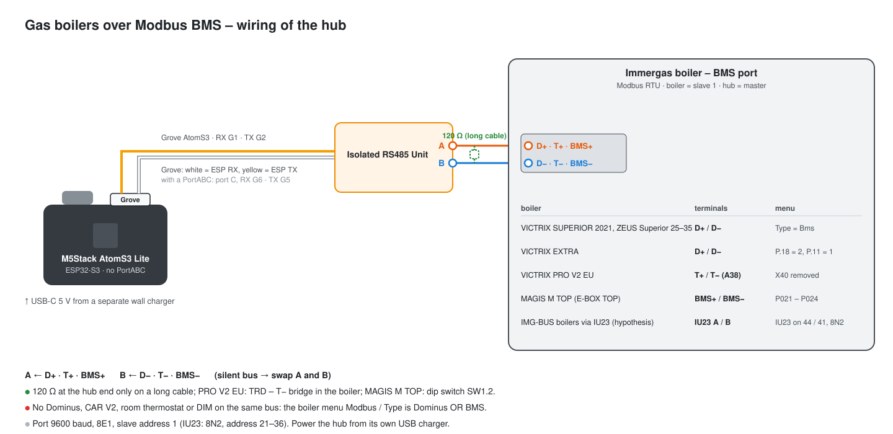

# Gas boilers over Modbus BMS (gb_ packages)

**English** · [Polski](gas-boiler-bms.pl.md)

Back to the [protocol overview](../README.md).

> **Experimental – not tested on a real boiler yet.** The packages follow the official VIPS gas specifications
> (*Specifikace protokolu Modbus*, version 02/2025) for VICTRIX SUPERIOR 2021, VICTRIX EXTRA and VICTRIX PRO V2 EU.
> If you have one of these boilers, please report what you see (see [Collecting logs](collecting-logs.md)).

In the BMS mode the boiler is a Modbus RTU **slave** and the hub is the **master**. The boiler is then only a heat
source: it heats to the flow setpoint the master gives it while the master keeps the heat request alive. The weather
curve, the room thermostat, zones and time programs are Home Assistant's job (or the optional `gb_curve` package).

**BMS and Dominus exclude each other.** The boiler menu *Modbus / Type* is Dominus **or** BMS, on the same D+ / D−
terminals. With BMS do not connect a Dominus, a CAR V2 / Immergas remote, a room thermostat, the wireless zone
controller or DIM units – the boiler reports a master conflict or ignores them.

## Hardware

| Part | |
|---|---|
| [M5Stack AtomS3 Lite](https://docs.m5stack.com/en/core/AtomS3%20Lite) | ESP32-S3; the RS485 unit goes into its own Grove port (RX GPIO1, TX GPIO2) – **no ATOMIC PortABC needed** for one bus (with a PortABC: Port C, RX GPIO6, TX GPIO5) |
| 1× M5Stack Isolated RS485 Unit | galvanic isolation, automatic direction (no DE pin) |

Any ESP32 with an RS485 transceiver works: set `gb_uart_rx_pin` / `gb_uart_tx_pin` (and a `flow_control_pin` on
`gb_modbus` for a transceiver with a direction pin). Port: 9600 baud, 8E1, slave address 1.

## Boilers and wiring

| Boiler | Package | Bus | Boiler menu |
|---|---|---|---|
| VICTRIX SUPERIOR 2021, VICTRIX ZEUS Superior 25 / 30 / 35 | `gb_superior` | D+ / D−, jumper X40 stays | MENU / Service / Modbus, Type = Bms (code 1122); boiler board FW 1.05+, display FW 1.31+ |
| VICTRIX EXTRA (28 / 32, 12 / 24 / 35 PLUS) | `gb_extra` | D+ / D−, X40 stays | P.18 = 2 (BMS), P.11 = 1 (code 69) |
| VICTRIX PRO V2 EU (and its simple cascade) | `gb_pro` | **T+ / T−** of terminal block A38, X40 removed | nothing to switch on (code 123 only for the port) |
| **IMG-BUS boilers through the IU23 interface** (VICTRIX ZEUS, ZEUS SUPERIOR, EXA, TERA, OMNIA, HERCULES (MINI) CONDENSING, MAIOR TT, KW TT, ARES CONDENSING 32 …) – *hypothesis* | `gb_iu23` | IU23 (kit 3.029912) on the remote terminals **44 / 41** instead of the CAR V2; the hub on its RS485 A / B | nothing in the boiler; IU23 dip switches = address 21–36 (all OFF = 21); port 9600 **8N2** |
| **MAGIS M TOP** heat pump (R290, E-BOX TOP) | `gb_mtop` | **BMS+ / BMS−** of the E-BOX TOP (A13), termination dip switch SW1.2 | panel menu P: P021 = On (control), P022 = 1, P023 = 3 (9600), P024 = 1 (even / 1) – check P023 / P024 first, users found 2400 baud at delivery |

Wiring rules:

- **Polarity:** D+ (BMS+, T+) → A, D− (BMS−, T−) → B; a silent bus means swapped wires.
- **Termination:** the D+ / D− boilers – 120 Ω on the hub end if the cable is long; PRO V2 EU – the TRD – T− bridge in
  the boiler; MAGIS M TOP – dip switch SW1.2 of the E-BOX TOP.
- **No Dominus** on the same bus: *Modbus / Type* is Dominus **or** BMS.

Factory port: **9600 baud, 8E1, slave address 1** on all of them. PRO V2 EU: 120 Ω termination with the TRD – T− bridge
and, when the master has no pull-ups, the TR+ – T+ and TR− – T− bridges.



## Installation

> 📄 **Configuration file: [`examples/immergas-gas-bms.yaml`](../examples/immergas-gas-bms.yaml)**
> ([open on GitHub](https://github.com/jotuera/immergas-modbus-bms-nasa-opentherm-hub/blob/main/examples/immergas-gas-bms.yaml) · [download (raw)](https://raw.githubusercontent.com/jotuera/immergas-modbus-bms-nasa-opentherm-hub/main/examples/immergas-gas-bms.yaml))

**In the boiler menu first** switch the Modbus port to BMS (SUPERIOR: MENU / Service / Modbus, Type = Bms, code 1122;
EXTRA: P.18 = 2 and P.11 = 1, code 69; MAGIS M TOP: P021 = On, P023 = 3, P024 = 1) and disconnect the Dominus if there
is one. **Heating** then needs the *Heat request (CH)* switch on – drive it from a room thermostat automation.

1. **Copy the configuration.** Save [`immergas-gas-bms.yaml`](../examples/immergas-gas-bms.yaml) into your ESPHome folder (in Home Assistant:
   *ESPHome → New device → Continue → Skip*, then paste its content into the new file).
2. **Add the secrets** it uses to `secrets.yaml`: `wifi_ssid`, `wifi_password`, `immergas_gas_api_key`, `immergas_gas_ota_password`.
3. **Pick what you need** in the `packages:` block at the end of the file:

   ```yaml
   files:
     - packages/lang/gb_en.yaml        # or gb_pl.yaml
     - packages/gb_core.yaml
     - packages/gb_control.yaml
     - packages/gb_status.yaml
     - packages/gb_sensors.yaml
     - packages/gb_superior.yaml       # or gb_extra / gb_pro / gb_mtop / gb_iu23
     - packages/gb_curve.yaml          # optional: weather curve in the hub
     - packages/gb_programs.yaml       # optional: CH / DHW programs, anti-legionella, vacation, summer / winter
     - packages/gb_boiler_params.yaml  # optional: boiler model / interface + service reminder
   ```

   - **Exactly one model package:** `gb_superior` (VICTRIX SUPERIOR 2021 / ZEUS Superior 25–35), `gb_extra`
     (VICTRIX EXTRA), `gb_pro` (VICTRIX PRO V2 EU), `gb_mtop` (MAGIS M TOP heat pump) or `gb_iu23` (an IMG-BUS boiler
     through the IU23 interface).
   - `gb_curve` only when the hub should compute the flow setpoint from the outdoor probe; otherwise Home Assistant
     sets *CH flow setpoint*.
4. **Check the pins** (`substitutions:` at the top) if your board is not an AtomS3 Lite with the unit in its Grove port.
5. **Flash** the device (USB the first time, then over the air) and **add it in Home Assistant** (*Settings → Devices
   & services* – it is found automatically).
6. **Check the connection:** *Immergas Gas - Fault* shows *No fault* and the temperatures follow the boiler; the boiler display shows the BMS / external device icon. E144 (PRO: fault 100) = no frames for 30 s – check the wiring and the boiler menu.

## Packages

| Package | What it gives |
|---|---|
| `gb_core` | UART / Modbus, the *BMS connection* switch, the **Heat request (CH)** switch – while on, the hub writes 0x0055 to register 512 every 10 s (the request expires after 30 s) |
| `gb_control` | *Operating mode* (Standby / DHW only / Heating / Heating + DHW), *CH flow setpoint* (514), *DHW setpoint* (515), *Fault reset* (257 = 0xAA55) |
| `gb_status` | state bits (flame, CH / DHW pump, CH / DHW / frost allowed, special function, resettable / locked fault), fault code and text, the boiler's CH / DHW limits, port configuration |
| `gb_sensors` | flow, return, DHW, outdoor, modulation, calculated flow, temperature after the separator (HVDT) |
| `gb_superior` / `gb_extra` / `gb_pro` / `gb_mtop` / `gb_iu23` | the model extras below – load exactly one |
| `gb_curve` (optional) | weather curve in the hub: every minute the CH flow setpoint from the boiler's outdoor probe, between two points, clamped to the boiler limits |
| `gb_programs` (optional, with `gb_curve`) | the programs of a room unit run in the hub: CH program AUTO (4 calendars × 4 ranges, a calendar per weekday; Eco lowers the flow – the curve or the setpoint – or drops the heat request), DHW program (Comfort / Eco DHW setpoint), anti-legionella (weekly / daily at 02:00, held 20 min), vacation (Standby / DHW only until a date), automatic Summer / Winter by the 24 h outdoor mean |
| `gb_computed` (optional) | delta T, mean loop temperature, flow minus the CH setpoint (514) and minus the calculated flow, flow minus HVDT, *Condensing operation* (return below `gb_dew_point`, 55 °C), burner power (measured heat from a model add-on, else from the modulation with `gb_boiler_kw` / `gb_min_modulation`), *Operating state* as one text |
| `gb_analytics` (optional, with `gb_computed`) | today: burner starts and starts in the last hour, burner time, average / last burn, short burns (`gb_short_burn_min`, 5), the last pause, average modulation and the share at the minimum, condensing share, heat, gas (heating / DHW) and a gas counter in m³ (`gb_gas_kwh_per_m3`, 10.6), gas price and cost; for the *Today · boiler analysis* card |
| `gb_superior_calc` / `gb_extra_calc` / `gb_pro_calc` (optional, per model, with `gb_computed`) | SUPERIOR: heat output measured from the pump flow, flue − return, DHW draws / litres / heat from the DHW flow and the measured cold water; EXTRA: measured heat, flue − return, 24 h pressure drop with *Possible leak* (`gb_leak_bar_day`, 0.2 bar), DHW share of the burner hours; PRO: flue − return, pressure drop / leak, average ionisation current with *Low ionisation* (`gb_ion_low_ua`, 2 µA) |
| `gb_mtop_calc` (optional, MAGIS M TOP, instead of `gb_computed` / `gb_analytics` – no burner) | delta T, mean loop, heat output measured from the system flow and heat today, pressure drop / leak, heat pump time and defrosts today, *Operating state* |
| `gb_boiler_params` (optional) | the boiler model / interface (the cards show how to switch BMS on at the boiler) and the service reminder (last service, interval, service done, due) |
| `gb_busmap` (optional) | register scanner for the Bus map card: reads the usual BMS register ranges one by one (a few minutes) and keeps those that answer and that no gb_ package reads; *Report bus map* turns them into a pre-filled GitHub issue |
| `lang/gb_en`, `lang/gb_pl` | entity names (`gb_name_prefix`, default "Immergas Gas") |

The configuration file and the steps are in [Installation](#installation).

## Register map

Read-only registers answer only function 0x04 (input), read / write ones 0x03 / 0x06 / 0x10 (holding). Temperatures
and percentages are in 0.1 units unless noted.

| Register | Type | Meaning | SUP | EXT | PRO |
|---|---|---|---|---|---|
| 0 | input | state: bit0 special function, bit1 DHW allowed, bit2 CH allowed, bit3 frost protection allowed, bit4 burner on, bit5 pump / valve CH, bit6 pump / valve DHW, bit9 BOOST off (SUP / EXT) or ECO on (PRO), bit12 resettable fault, bit13 locked fault | ✓ | ✓ | ✓ |
| 1 | input | fault code | ✓ | ✓ | ✓ |
| 256 | holding | control: bit1 allow DHW, bit2 allow CH (SUP: also sets bit1), bit9 BOOST off (SUP / EXT) / ECO on (PRO) | ✓ | ✓ | ✓ |
| 257 | holding | 0xAA55 = fault reset | ✓ | ✓ | ✓ |
| 512 | holding | heat request 0x0055 (PRO also 0x0155 = without the DHW priority), expires after 30 s | ✓ | ✓ | ✓ |
| 513 | holding | upper power limit (0.1 %) | – | – | ✓ |
| 514 / 515 | holding | CH flow / DHW setpoint | ✓ | ✓ | ✓ |
| 768 / 769 / 770 | input | flow / return / DHW temperature | ✓ | ✓ | ✓ |
| 771 | input | flue gas temperature | whole °C | 0.1 °C | 0.1 °C |
| 772 | input | outdoor temperature (with the probe) | ✓ | ✓ | ✓ |
| 773 | input | system pressure (0.1 bar) | – | ✓ | ✓ |
| 774 | input | ionisation current (0.1 µA) | – | – | ✓ |
| 775 / 776 / 777 | input | modulation / calculated flow / after HVDT | ✓ | ✓ | ✓ |
| 778 | input | DHW inlet temperature | ✓ | ✓ | – |
| 779 / 780 | input | DHW flow / pump flow (l/min) | ✓ / ✓ | – / ✓ | – |
| 781 | input | fan speed (rpm) | ✓ | ✓ | – |
| 837–840 | input | burner hours DHW / CH (high, low word) | – | ✓ | – |
| 841–842 | input | burner hours (high, low word) | ✓ | – | – |
| 1024–1027 | input | CH max / min, DHW max / min | ✓ | ✓ | ✓ |
| 61440–61442 | holding | slave address, parity / stop / baud, 0xCC33 = apply | ✓ | ✓ | ✓ |

**MAGIS M TOP** (manual ST.010018/001, chapter 1.23) uses the same map with a heat pump on top: state bits 7 heat
pump active, 8 cooling allowed, 9 DHW ECO, 10 antifreeze active, 11 defrost (no burner bit); 256 bit8 allows cooling and
bit9 is DHW ECO (normal logic); 512 low byte 0x55 heating / **0xAA cooling** / 0x00 end, high byte bit0 CH before DHW
and bit4 silent mode; 513 max. power (0–1000 = 0–100 %); 773 pressure in **0.01 bar**; 782 system flow (l/h);
1028 / 1029 cooling max / min. No COP, compressor frequency or energy – the heat pump shows itself as a heat generator.
`gb_mtop` adds *Request type* (heating / cooling), *Allow cooling*, *DHW ECO*, *CH before DHW*, *Silent mode* and
*Upper power limit*; the *Heat request* switch of `gb_core` then sends the chosen request.

**IU23 – IMG-BUS boilers (hypothesis).** The Immergas IU23 interface (kit 3.029912, instructions 1.043047) turns the
IMG-BUS remote bus of a boiler into a Modbus RTU slave: 9600 baud, 8N2, address 21–36 by four dip switches, powered from
the IMG BUS (< 5 mA), no termination. Its instructions do not list the registers. The Immergas System Manager
(3.021522, chapter 8.2) connects the BMS boilers and the IU23 boilers with the same slave address 21, the same 8N2 frame
and the same functions – CH / DHW mode, flow setpoint, DHW setpoint, remote reading of parameters and faults – so the
IU23 most likely serves this same register map. `gb_iu23` loads only the common registers (state, control, setpoints,
fault, temperatures, modulation) with 8N2 and address 21; the model extras stay out until a module shows which
registers answer. Not confirmed on a module yet. A CAR-BUS boiler (CAR V2 shows *VER PC*) has no IMG BUS for the IU23.

**Watchdog.** More than 30 s without a frame from the master: **E144** "BMS offline" (SUP, EXT) or fault **100**
(PRO); it clears by itself at the first correct frame. The fast poll runs every 10 s.

**Still to confirm on a boiler:** the address offset (the tables give raw addresses), whether the outdoor value is
signed and what "no probe" reads, the flow resolution, the hours formula (the PDF says 65535 × high), and on the EXTRA /
PRO whether bit2 alone also allows DHW. None of the specifications lists the fault codes beyond 144 / 100.

## Knowledge base

- Official VIPS gas *Specifikace protokolu Modbus* (version 02/2025) for VICTRIX SUPERIOR 2021, VICTRIX EXTRA and
  VICTRIX PRO V2 EU – the source of the register map above.
- MAGIS M TOP installer manual ST.010018/001, chapter 1.23 (BMS configuration, P021–P024).
- Boiler menus of the new platform (Modbus / Type, Remote control, master conflict E145, Dominus unavailable E142):
  the installer manuals of ZEUS Superior 25 / 30 / 35, HERCULES 25 / 35 and EXTRA on immergas.pl.
- With a Dominus instead of BMS the same boilers run over the Dominus TCP:
  [Immergas Dominus – Modbus map, gas boilers](https://github.com/jotuera/immergas-dominus/blob/main/docs/pdu-map.md).
