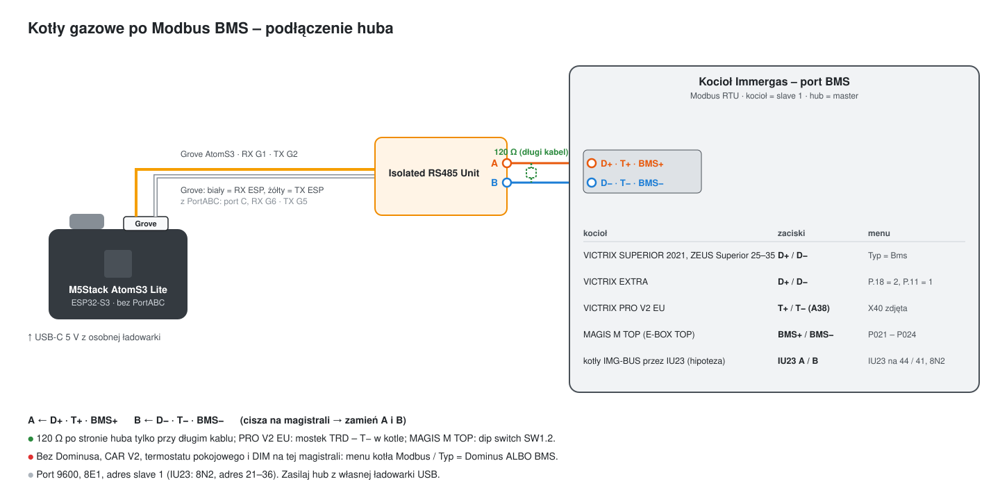

# Kotły gazowe po Modbus BMS (pakiety gb_)

[English](gas-boiler-bms.md) · **Polski**

Powrót do [przeglądu protokołów](../README.pl.md).

> **Eksperymentalne – jeszcze nie testowane na prawdziwym kotle.** Pakiety idą za oficjalnymi specyfikacjami VIPS gas
> (*Specifikace protokolu Modbus*, wersja 02/2025) dla VICTRIX SUPERIOR 2021, VICTRIX EXTRA i VICTRIX PRO V2 EU.
> Masz taki kocioł – zgłoś, co widzisz (patrz [Zbieranie logów](collecting-logs.pl.md)).

W trybie BMS kocioł jest **slave'em** Modbus RTU, a hub **masterem**. Kocioł jest wtedy tylko źródłem ciepła: grzeje
do temperatury zasilania podanej przez mastera, dopóki master podtrzymuje żądanie grzania. Krzywa pogodowa, termostat
pokojowy, strefy i harmonogramy to zadanie Home Assistanta (albo opcjonalnego pakietu `gb_curve`).

**BMS i Dominus się wykluczają.** Menu kotła *Modbus / Typ* to Dominus **albo** BMS, na tych samych zaciskach D+ / D−.
Przy BMS nie podłączaj Dominusa, CAR V2 / pilota Immergas, termostatu pokojowego, bezprzewodowej centrali stref ani
modułów DIM – kocioł zgłosi konflikt mastera albo je pominie.

## Sprzęt

| Element | |
|---|---|
| [M5Stack AtomS3 Lite](https://docs.m5stack.com/en/core/AtomS3%20Lite) | ESP32-S3; moduł RS485 w jego własnym gnieździe Grove (RX GPIO1, TX GPIO2) – przy jednej magistrali **ATOMIC PortABC nie jest potrzebny** (z PortABC: port C, RX GPIO6, TX GPIO5) |
| 1× M5Stack Isolated RS485 Unit | izolacja galwaniczna, automatyczny kierunek (bez pinu DE) |

Port: 9600 bodów, 8E1, adres slave 1.

## Kotły i podłączenie

| Kocioł | Pakiet | Magistrala | Menu kotła |
|---|---|---|---|
| VICTRIX SUPERIOR 2021, VICTRIX ZEUS Superior 25 / 30 / 35 | `gb_superior` | D+ / D−, zworka X40 zostaje | MENU / Serwis / Modbus, Typ = Bms (kod 1122); FW płyty kotła 1.05+, wyświetlacza 1.31+ |
| VICTRIX EXTRA (28 / 32, 12 / 24 / 35 PLUS) | `gb_extra` | D+ / D−, X40 zostaje | P.18 = 2 (BMS), P.11 = 1 (kod 69) |
| VICTRIX PRO V2 EU (także prosta kaskada) | `gb_pro` | **T+ / T−** listwy A38, X40 zdjęta | nic nie trzeba włączać (kod 123 tylko dla parametrów portu) |
| **Kotły IMG-BUS przez interfejs IU23** (VICTRIX ZEUS, ZEUS SUPERIOR, EXA, TERA, OMNIA, HERCULES (MINI) CONDENSING, MAIOR TT, KW TT, ARES CONDENSING 32 …) – *hipoteza* | `gb_iu23` | IU23 (kit 3.029912) na zaciskach pilota **44 / 41** zamiast CAR V2; hub na jego RS485 A / B | nic w kotle; dipswitche IU23 = adres 21–36 (wszystkie OFF = 21); port 9600 **8N2** |
| Pompa ciepła **MAGIS M TOP** (R290, E-BOX TOP) | `gb_mtop` | **BMS+ / BMS−** płyty E-BOX TOP (A13), terminacja przełącznikiem SW1.2 | menu P panelu: P021 = On (sterowanie), P022 = 1, P023 = 3 (9600), P024 = 2 (**bez parzystości** / 1) – najpierw sprawdź P023 / P024, użytkownicy zastali fabrycznie 2400 bodów |

Starszego VICTRIX PRO 2 ErP nie ma na tej liście: jego instrukcje nie opisują Modbusa, OpenTherm ani IMG BUS, tylko termostat
on/off, wejście 0–10 V i magistralę kaskady.

Zasady podłączenia:

- **Polaryzacja:** D+ (BMS+, T+) → A, D− (BMS−, T−) → B; cisza na magistrali to zwykle zamienione przewody.
- **Terminacja:** kotły na D+ / D− – 120 Ω po stronie huba przy długim kablu; PRO V2 EU – mostek TRD – T− w kotle;
  MAGIS M TOP – przełącznik SW1.2 płyty E-BOX TOP.
- **Bez Dominusa** na tej samej magistrali: *Modbus / Typ* to Dominus **albo** BMS.

Port fabrycznie: **9600 bodów, 8E1, adres slave 1** w kotłach gazowych. MAGIS M TOP: 9600 **8N1** (P024 = 2) – E-BOX TOP to
płyta A13 jak w MAGIS PRO / COMBO, których BMS działa bez parzystości; `gb_mtop` sam ustawia 8N1 (przy 8E1 pompa
w ogóle nie odpowiadała; 8N1 do potwierdzenia na urządzeniu). PRO V2 EU: terminacja 120 Ω mostkiem TRD – T−,
a gdy master nie ma rezystorów podciągających – mostki TR+ – T+ i TR− – T−.



## Instalacja

> 📄 **Plik konfiguracji: [`examples/immergas-gas-bms.yaml`](../examples/immergas-gas-bms.yaml)**
> ([otwórz na GitHubie](https://github.com/jotuera/immergas-modbus-bms-nasa-opentherm-hub/blob/main/examples/immergas-gas-bms.yaml) · [pobierz (raw)](https://raw.githubusercontent.com/jotuera/immergas-modbus-bms-nasa-opentherm-hub/main/examples/immergas-gas-bms.yaml))

**Najpierw w menu kotła** przełącz port Modbus na BMS (SUPERIOR: MENU / Serwis / Modbus, Typ = Bms, kod 1122; EXTRA:
P.18 = 2 i P.11 = 1, kod 69; MAGIS M TOP: P021 = On, P023 = 3, P024 = 2) i odłącz Dominusa, jeśli jest. **Grzanie**
wymaga potem włączonego przełącznika *Żądanie grzania (CO)* – steruj nim automatyzacją termostatu pokojowego.

1. **Skopiuj konfigurację.** Zapisz [`immergas-gas-bms.yaml`](../examples/immergas-gas-bms.yaml) w folderze ESPHome (w Home Assistant: *ESPHome →
   Nowe urządzenie → Kontynuuj → Pomiń*, a potem wklej treść do nowego pliku).
2. **Dodaj sekrety**, których używa, do `secrets.yaml`: `wifi_ssid`, `wifi_password`, `immergas_gas_api_key`, `immergas_gas_ota_password`.
3. **Wybierz, czego potrzebujesz** w bloku `packages:` na końcu pliku:

   ```yaml
   files:
     - packages/lang/gb_en.yaml        # albo gb_pl / _cs / _de / _es / _fr / _hu / _it / _nl / _pt / _sk
     - packages/gb_core.yaml
     - packages/gb_control.yaml
     - packages/gb_status.yaml
     - packages/gb_sensors.yaml
     - packages/gb_superior.yaml       # albo gb_extra / gb_pro / gb_mtop / gb_iu23
     - packages/gb_curve.yaml          # opcjonalnie: krzywa pogodowa w hubie
     - packages/gb_programs.yaml       # opcjonalnie: programy CO / CWU, anty-legionella, wyjazd, Lato / Zima
     - packages/gb_boiler_params.yaml  # opcjonalnie: model kotła / interfejs + przypomnienie o przeglądzie
   ```

   - **Dokładnie jeden pakiet modelu:** `gb_superior` (VICTRIX SUPERIOR 2021 / ZEUS Superior 25–35), `gb_extra`
     (VICTRIX EXTRA), `gb_pro` (VICTRIX PRO V2 EU), `gb_mtop` (pompa ciepła MAGIS M TOP) albo `gb_iu23` (kocioł IMG-BUS
     przez interfejs IU23).
   - `gb_curve` tylko wtedy, gdy hub ma liczyć nastawę zasilania z sondy zewnętrznej; inaczej *Nastawę zasilania CO*
     ustawia Home Assistant.
4. **Sprawdź piny** (`substitutions:` na górze), jeśli twoja płytka to nie AtomS3 Lite z modułem w gnieździe Grove.
5. **Wgraj** urządzenie (pierwszy raz przez USB, potem przez sieć) i **dodaj je w Home Assistant** (*Ustawienia →
   Urządzenia i usługi* – znajdzie się samo).
6. **Sprawdź połączenie:** *Immergas Gas - Usterka* pokazuje *Brak usterki*, a temperatury idą za kotłem; na wyświetlaczu kotła pojawia się ikona BMS / urządzenia zewnętrznego. E144 (PRO: błąd 100) = brak ramek przez 30 s – sprawdź podłączenie i menu kotła.

## Pakiety

| Pakiet | Co daje |
|---|---|
| `gb_core` | UART / Modbus, przełącznik *Połączenie BMS*, przełącznik **Żądanie grzania (CO)** – gdy włączony, hub co 10 s wpisuje 0x0055 do rejestru 512 (żądanie wygasa po 30 s) |
| `gb_control` | *Tryb pracy* (Stand-by / Tylko CWU / Ogrzewanie / Ogrzewanie + CWU), *Nastawa zasilania CO* (514), *Nastawa CWU* (515), *Reset usterki* (257 = 0xAA55) |
| `gb_status` | bity stanu (płomień, pompa CO / CWU, CO / CWU / ochrona przed zamarzaniem dozwolone, funkcja specjalna, usterka kasowalna / niekasowalna), kod i opis usterki (teksty błędów Immergasa jak w D+/D- i T-/T+, 11 języków; 144 i 100 = łącze BMS), limity CO / CWU kotła, konfiguracja portu |
| `gb_sensors` | zasilanie, powrót, CWU, temp. zewnętrzna, modulacja, obliczone zasilanie, temperatura za sprzęgłem (HVDT) |
| `gb_superior` / `gb_extra` / `gb_pro` / `gb_mtop` / `gb_iu23` | dodatki modelu z tabeli niżej – wczytaj dokładnie jeden |
| `gb_curve` (opcjonalny) | krzywa pogodowa w hubie: co minutę nastawa zasilania CO z sondy zewnętrznej kotła, między dwoma punktami, w granicach limitów kotła |
| `gb_programs` (opcjonalny, z `gb_curve`) | programy pilota liczone w hubie: program CO AUTO (4 kalendarze × 4 zakresy, kalendarz na każdy dzień; Eko obniża zasilanie – krzywą albo nastawę – albo zdejmuje żądanie grzania), program CWU (nastawa Komfort / Eko), anty-legionella (co tydzień / codziennie o 02:00, trzymana 20 min), tryb wyjazdowy (Stand-by / tylko CWU do daty), automatyczne Lato / Zima wg średniej zewnętrznej 24 h |
| `gb_computed` (opcjonalny) | delta T, średnia obiegu, zasilanie minus nastawa CO (514) i minus temperatura obliczona, zasilanie minus HVDT, *Praca kondensacyjna* (powrót poniżej `gb_dew_point`, 55 °C), moc palnika (zmierzona z dodatku modelu, inaczej z modulacji wg `gb_boiler_kw` / `gb_min_modulation`), *Stan pracy* jako jeden tekst |
| `gb_analytics` (opcjonalny, z `gb_computed`) | dziś: starty palnika i starty w ostatniej godzinie, czas palnika, średnie / ostatnie palenie, krótkie palenia (`gb_short_burn_min`, 5), ostatnia przerwa, średnia modulacja i udział minimalnej, udział kondensacji, ciepło, gaz (CO / CWU) i licznik gazu w m³ (`gb_gas_kwh_per_m3`, 10,6), cena i koszt gazu; dla karty *Dziś · analiza kotła* |
| `gb_superior_calc` / `gb_extra_calc` / `gb_pro_calc` (opcjonalne, wg modelu, z `gb_computed`) | SUPERIOR: moc cieplna zmierzona z przepływu pompy, spaliny − powrót, pobory / litry / ciepło CWU z przepływu CWU i zmierzonej wody zimnej; EXTRA: zmierzona moc, spaliny − powrót, spadek ciśnienia w 24 h z *Możliwym wyciekiem* (`gb_leak_bar_day`, 0,2 bar), udział CWU w godzinach palnika; PRO: spaliny − powrót, spadek ciśnienia / wyciek, średni prąd jonizacji z *Niską jonizacją* (`gb_ion_low_ua`, 2 µA) |
| `gb_mtop_calc` (opcjonalny, MAGIS M TOP, zamiast `gb_computed` / `gb_analytics` – bez palnika) | delta T, średnia obiegu, moc cieplna zmierzona z przepływu instalacji i ciepło dziś, spadek ciśnienia / wyciek, czas pracy pompy ciepła i odszraniania dziś, *Stan pracy* |
| `gb_boiler_params` (opcjonalny) | model kotła / interfejs (karty pokazują, jak włączyć BMS na kotle) i przypomnienie o przeglądzie (ostatni przegląd, interwał, przegląd wykonany, termin) |
| `gb_busmap` (opcjonalny) | skaner rejestrów dla karty Mapa magistral: czyta po kolei typowe zakresy rejestrów BMS (kilka minut) i zostawia te, które odpowiadają, a żaden pakiet gb_ ich nie czyta; *Zgłoś mapę magistrali* robi z nich gotowe zgłoszenie na GitHubie |
| `lang/gb_en`, `lang/gb_pl` | nazwy encji (`gb_name_prefix`, domyślnie „Immergas Gas”) |

Plik konfiguracji i kroki są w sekcji [Instalacja](#instalacja).

## Mapa rejestrów

Rejestry tylko do odczytu odpowiadają wyłącznie na funkcję 0x04 (input), zapisywalne na 0x03 / 0x06 / 0x10 (holding).
Temperatury i procenty w jednostkach 0,1, chyba że zaznaczono inaczej.

| Rejestr | Typ | Znaczenie | SUP | EXT | PRO |
|---|---|---|---|---|---|
| 0 | input | stan: bit0 funkcja specjalna, bit1 CWU dozwolona, bit2 CO dozwolone, bit3 ochrona przed zamarzaniem dozwolona, bit4 palnik, bit5 pompa / zawór CO, bit6 pompa / zawór CWU, bit9 BOOST wyłączony (SUP / EXT) albo ECO włączone (PRO), bit12 usterka kasowalna, bit13 usterka niekasowalna | ✓ | ✓ | ✓ |
| 1 | input | kod usterki | ✓ | ✓ | ✓ |
| 256 | holding | sterowanie: bit1 zezwól CWU, bit2 zezwól CO (SUP: ustawia też bit1), bit9 BOOST wył. (SUP / EXT) / ECO wł. (PRO) | ✓ | ✓ | ✓ |
| 257 | holding | 0xAA55 = reset usterki | ✓ | ✓ | ✓ |
| 512 | holding | żądanie grzania 0x0055 (PRO także 0x0155 = bez priorytetu CWU), wygasa po 30 s | ✓ | ✓ | ✓ |
| 513 | holding | górny limit mocy (0,1 %) | – | – | ✓ |
| 514 / 515 | holding | nastawa zasilania CO / CWU | ✓ | ✓ | ✓ |
| 768 / 769 / 770 | input | temperatura zasilania / powrotu / CWU | ✓ | ✓ | ✓ |
| 771 | input | temperatura spalin | pełne °C | 0,1 °C | 0,1 °C |
| 772 | input | temperatura zewnętrzna (z sondą) | ✓ | ✓ | ✓ |
| 773 | input | ciśnienie w instalacji (0,1 bar) | – | ✓ | ✓ |
| 774 | input | prąd jonizacji (0,1 µA) | – | – | ✓ |
| 775 / 776 / 777 | input | modulacja / obliczone zasilanie / za HVDT | ✓ | ✓ | ✓ |
| 778 | input | temperatura wody zimnej CWU | ✓ | ✓ | – |
| 779 / 780 | input | przepływ CWU / pompy (l/min) | ✓ / ✓ | – / ✓ | – |
| 781 | input | obroty wentylatora (rpm) | ✓ | ✓ | – |
| 837–840 | input | godziny palnika CWU / CO (słowo starsze, młodsze) | – | ✓ | – |
| 841–842 | input | godziny palnika (słowo starsze, młodsze) | ✓ | – | – |
| 1024–1027 | input | maks. / min. CO, maks. / min. CWU | ✓ | ✓ | ✓ |
| 61440–61442 | holding | adres slave, parzystość / stop / prędkość, 0xCC33 = zastosuj | ✓ | ✓ | ✓ |

**MAGIS M TOP** (instrukcja ST.010018/001, rozdz. 1.23) ma tę samą mapę z dodatkiem pompy ciepła: bity stanu 7 pompa
ciepła aktywna, 8 chłodzenie dozwolone, 9 CWU ECO, 10 ochrona przed zamarzaniem aktywna, 11 odszranianie (bez bitu
palnika); 256 bit8 zezwala na chłodzenie, bit9 to CWU ECO (zwykła logika); 512 młodszy bajt 0x55 grzanie / **0xAA
chłodzenie** / 0x00 koniec, starszy bajt bit0 CO przed CWU i bit4 tryb cichy; 513 maks. moc (0–1000 = 0–100 %);
773 ciśnienie w **0,01 bar**; 782 przepływ instalacji (l/h); 1028 / 1029 maks. / min. chłodzenia. Nie ma COP,
częstotliwości sprężarki ani energii – pompa przedstawia się jako generator ciepła. `gb_mtop` dodaje *Rodzaj żądania*
(grzanie / chłodzenie), *Zezwól na chłodzenie*, *CWU ECO*, *CO przed CWU*, *Tryb cichy* i *Górny limit mocy*;
przełącznik *Żądanie grzania* z `gb_core` wysyła wtedy wybrane żądanie.

**IU23 – kotły IMG-BUS (hipoteza).** Interfejs Immergas IU23 (kit 3.029912, instrukcja 1.043047) zamienia magistralę
pilota IMG-BUS kotła na slave Modbus RTU: 9600 bodów, 8N2, adres 21–36 czterema dipswitchami, zasilany z IMG BUS
(< 5 mA), bez terminacji. Jego instrukcja nie podaje rejestrów. Centralka systemu Immergas (3.021522, rozdział 8.2)
łączy kotły BMS i kotły z IU23 z tym samym adresem slave 21, tą samą ramką 8N2 i tymi samymi funkcjami – tryb CO / CWU,
nastawa zasilania, nastawa CWU, zdalny odczyt parametrów i błędów – więc IU23 najpewniej wystawia tę samą mapę
rejestrów. `gb_iu23` wczytuje tylko wspólne rejestry (stan, sterowanie, nastawy, usterka, temperatury, modulacja) z 8N2
i adresem 21; dodatki modeli zostają poza nim, dopóki moduł nie pokaże, które rejestry odpowiadają. Jeszcze
niepotwierdzone na module. Kocioł z CAR-BUS (CAR V2 pokazuje *VER PC*) nie ma IMG BUS dla IU23.

**Watchdog.** Ponad 30 s bez ramki od mastera: **E144** „BMS offline” (SUP, EXT) albo błąd **100** (PRO); kasuje się
sam przy pierwszej poprawnej ramce. Szybkie odpytywanie co 10 s.

**Do potwierdzenia na kotle:** przesunięcie adresów (tabele podają adresy surowe), czy temp. zewnętrzna ma znak i co
pokazuje „brak sondy”, rozdzielczość przepływów, wzór godzin (PDF podaje 65535 × starsze), a w EXTRA / PRO – czy sam
bit2 zezwala też na CWU. Żadna specyfikacja nie podaje kodów usterek poza 144 / 100.

## Baza wiedzy

- Oficjalne *Specifikace protokolu Modbus* VIPS gas (wersja 02/2025) dla VICTRIX SUPERIOR 2021, VICTRIX EXTRA
  i VICTRIX PRO V2 EU – źródło mapy rejestrów powyżej.
- Instrukcja instalatora MAGIS M TOP ST.010018/001, rozdział 1.23 (konfiguracja BMS, P021–P024).
- Menu kotłów nowej platformy (Modbus / Typ, Zdalne sterowanie, konflikt mastera E145, Dominus niedostępny E142):
  instrukcje instalatora ZEUS Superior 25 / 30 / 35, HERCULES 25 / 35 i EXTRA na immergas.pl.
- Z Dominusem zamiast BMS te same kotły działają przez TCP Dominusa:
  [Immergas Dominus – mapa Modbus, kotły gazowe](https://github.com/jotuera/immergas-dominus/blob/main/docs/pdu-map.pl.md).
