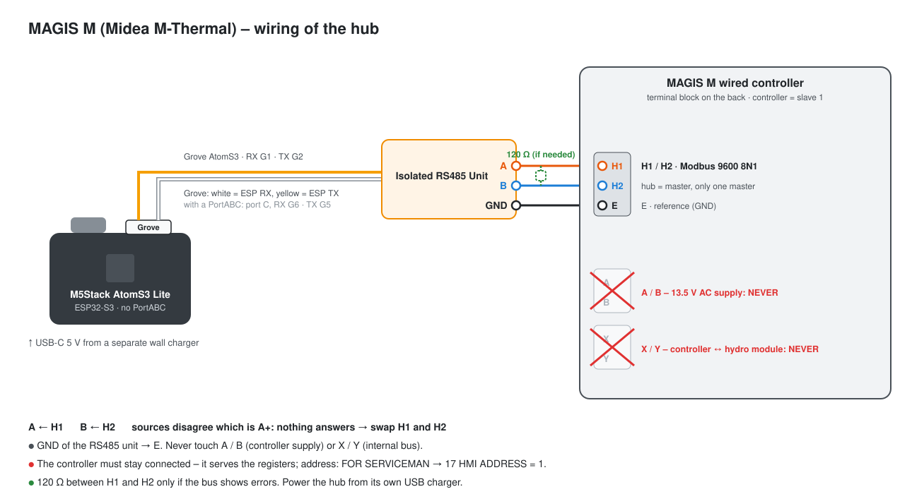

# MAGIS M heat pumps (Midea M-Thermal) – mt_ packages

**English** · [Polski](magis-m-midea.pl.md)

Back to the [protocol overview](../README.md).

> **Experimental – not tested on a MAGIS M yet.** The packages implement the Midea M-Thermal Modbus protocol the
> MAGIS M is built on. If you have one, please report what you see (see [Collecting logs](collecting-logs.md)).

The Immergas **MAGIS M** (M4 – M30, R32) is a Midea M-Thermal heat pump: wired controller with the H1 / H2 Modbus
port, the T1S / T4 / T5 / IBH / TBH names in the menu. It has nothing to do with the Samsung-based MAGIS PRO / COMBO V2
that the rest of this hub serves. The **MAGIS M TOP** (R290, E-BOX TOP) is different again: its BMS port speaks the
Immergas generator BMS protocol – the `gb_mtop` package, see [Gas boilers over Modbus BMS](gas-boiler-bms.md).

## Hardware

| Part | |
|---|---|
| [M5Stack AtomS3 Lite](https://docs.m5stack.com/en/core/AtomS3%20Lite) | ESP32-S3; the RS485 unit goes into its own Grove port (RX GPIO1, TX GPIO2) – **no ATOMIC PortABC needed** for one bus (with a PortABC: Port C, RX GPIO6, TX GPIO5) |
| 1× M5Stack Isolated RS485 Unit | galvanic isolation, automatic direction (no DE pin) |

Any ESP32 with an RS485 transceiver works (`mt_uart_rx_pin` / `mt_uart_tx_pin`).

## Wiring

| Hub (RS485) | Wired controller | Notes |
|---|---|---|
| A / B | **H1 / H2** | sources disagree which is A+ – nothing answers: swap them; a 120 Ω resistor between H1 and H2 may be needed |
| GND | **E** | reference |
| – | ~~A / B~~ | **never**: 13.5 V AC supply of the controller |
| – | ~~X / Y~~ | **never**: internal controller ↔ hydro module bus |

The hub is the master, the controller the slave: **9600 baud, 8N1, address 1** (controller menu *FOR SERVICEMAN →
17 HMI ADDRESS*). Only one master on H1 / H2, and the controller has to stay connected – it serves the registers.



## Installation

> 📄 **Configuration file: [`examples/immergas-magis-m.yaml`](../examples/immergas-magis-m.yaml)**
> ([open on GitHub](https://github.com/jotuera/immergas-modbus-bms-nasa-opentherm-hub/blob/main/examples/immergas-magis-m.yaml) · [download (raw)](https://raw.githubusercontent.com/jotuera/immergas-modbus-bms-nasa-opentherm-hub/main/examples/immergas-magis-m.yaml))

1. **Copy the configuration.** Save [`immergas-magis-m.yaml`](../examples/immergas-magis-m.yaml) into your ESPHome folder (in Home Assistant:
   *ESPHome → New device → Continue → Skip*, then paste its content into the new file).
2. **Add the secrets** it uses to `secrets.yaml`: `wifi_ssid`, `wifi_password`, `immergas_magis_m_api_key`, `immergas_magis_m_ota_password`.
3. **Pick what you need** in the `packages:` block at the end of the file:

   ```yaml
   files:
     - packages/lang/mt_en.yaml        # or mt_cs / _de / _es / _fr / _hu / _it / _nl / _pl / _pt / _sk
     - packages/mt_core.yaml
     - packages/mt_status.yaml
     - packages/mt_sensors.yaml
     - packages/mt_energy.yaml
     - packages/mt_control.yaml
     - packages/mt_params.yaml         # optional: installer parameters, read only
   ```

   - Start with all packages; leave out `mt_control` for a read-only first run.
   - `mt_energy_multiply` (substitution) if the energy counters come out 100× too small.
4. **Check the pins** (`substitutions:` at the top) if your board is not an AtomS3 Lite with the unit in its Grove port.
5. **Flash** the device (USB the first time, then over the air) and **add it in Home Assistant** (*Settings → Devices
   & services* – it is found automatically).
6. **Check the connection:** *Immergas M - Protocol version* and *Water outlet temperature* get values within a minute. Nothing = swap H1 / H2, check the 120 Ω resistor and the controller address (menu 17).

**Wait for the first readings before changing anything** – the on / off and function switches change single bits of
shared registers and use the last value read.

## Packages

| Package | What it gives |
|---|---|
| `mt_core` | UART / Modbus, *Modbus connection* switch, protocol version (187), the sensor resolution flag (189 bit8: 1 °C or 0.1 °C), the write helper |
| `mt_status` | running mode, current and last three faults (with the fault code and its description), defrost / antifreeze / oil return / thermostat / SG / EVU, heaters IBH1 / IBH2 / TBH, pumps, 3-way valve, alarm, running, software versions |
| `mt_sensors` | compressor and target frequency, fan, expansion valve, water in / out / total, outdoor, room, DHW tank, refrigerant temperatures, pressures, outdoor unit current and voltage, buffer tank, compressor hours, curve flow targets, water flow, heat output |
| `mt_energy` | electric and heat energy counters, heating and electric power, the unit's COP and the hub's own COP now |
| `mt_stats` (optional) | today's heat and electric energy, COP today, compressor starts and runtime today – counted in the hub, reset at midnight (Home Assistant time) |
| `mt_programs` (optional, with `mt_stats`) | programs run in the hub: CH program AUTO (4 calendars × 4 ranges, a calendar per weekday; Comfort / Eco room setpoint with the room temperature control, else Eco lowers the zone 1 water setpoint or switches zone 1 off), DHW program (Comfort / Eco), vacation (zone 1 and DHW off, or zone 1 only, until a date), automatic summer / winter (zone 1 on / off by the 24 h outdoor mean); the unit keeps its own disinfection |
| `mt_unit_params` (optional, with `mt_stats`) | the service reminder (last service, interval, service done, due); the cards show the installer parameters of `mt_params` (read only) as Unit parameters (offline) |
| `mt_costs` (optional, with `mt_energy`) | electricity price and DHW tank volume (kept in the hub), the heat pump heat cost (price ÷ COP) and the last DHW cycle – source, duration, electricity, heat from the cylinder and the flow, both COPs, cost and the same heat from the heater; for the *Heat pump or heater?* and *Last DHW cycle* cards |
| `mt_computed` (optional) | water delta T, thermal lift, mean loop temperature, heat output from the flow, deviation from the curve, buffer stratification; condensing / evaporating temperature from the pressures (`mt_refrigerant`: R32 / R290, `mt_pressure_offset_kpa`: 0 absolute / 101 gauge), suction superheat, subcooling, discharge superheat, compression ratio, ODU power from U × I; *Operating state* as one text |
| `mt_analytics` (optional, with `mt_stats`) | today: average / last compressor cycle and short cycles, defrosts (count, last duration, minutes since), heating vs DHW compressor time, electricity, heat and COP, COP since installation, IBH / TBH runtime and their estimated electricity (`mt_ibh1_kw`, `mt_ibh2_kw`, `mt_tbh_kw`), system COP with the heaters; for the *Today · operation analysis* card |
| `mt_busmap` (optional) | register scanner for the Bus map card: reads holding registers 0–299 one by one (a few minutes) and keeps those that answer and that no mt_ package reads; *Report bus map* turns them into a pre-filled GitHub issue |
| `mt_control` | on / off zone 1 / zone 2 / DHW / room control, operating mode (auto / cooling / heating), water setpoints zone 1 / 2, room and DHW setpoints, weather curve on / number, silent, ECO, disinfection, forced DHW / tank heater / backup heater |
| `mt_params` (optional) | read only: setpoint limits, heating outdoor limits, the custom heating curve |
| `lang/mt_en`, `lang/mt_pl` | entity names (`mt_name_prefix`, default "Immergas M") |

The configuration file and the steps are in [Installation](#installation).

## Register map (holding, function 0x03 / 0x06)

| Register | Meaning | Notes |
|---|---|---|
| 0 | on / off: bit0 room control, bit1 zone 1, bit2 DHW, bit3 zone 2 | bit field – the hub changes only its own bit |
| 1 | mode: 1 auto, 2 cooling, 3 heating | |
| 2 | water setpoint: low byte zone 1, high byte zone 2 | in °C, or °C × 2 with the 0.1 °C resolution |
| 3 | room setpoint | °C × 2 |
| 4 | DHW setpoint | °C |
| 5 | functions: bit4 disinfection, bit6 silent, bit10 ECO, bit12 / bit13 weather curve zone 1 / 2 | bit field |
| 6 | curve number: low byte zone 1, high byte zone 2 | 1–9 (9 = custom) |
| 7 / 8 / 9 | forced DHW / tank heater TBH / backup heater IBH | 0 as programmed, 1 on, 2 off |
| 100 / 132 | compressor / target frequency | Hz |
| 101 / 199 | running mode | 199: 0 off, 2 cooling, 3 heating, 5 DHW |
| 102 / 103 | fan speed / expansion valve | rpm / steps |
| 104 / 105 / 110 / 111 | water in / out / total / zone 2 | resolution flag |
| 106 / 108 / 109 / 112 / 113 | T3 coil, discharge, suction, T2 liquid, T2B gas | resolution flag |
| 107 / 114 / 115 | outdoor (T4) / room / DHW tank (T5) | resolution flag |
| 116 / 117 | high / low pressure | kPa (older protocol × 10) |
| 118 / 119 | outdoor unit current / voltage | A / V |
| 120 / 121 | buffer tank top / bottom | |
| 122 / 123 | compressor hours / unit capacity | h / kW |
| 124–127 | current fault, last three faults | code |
| 128 | status bits: 1 defrost, 2 antifreeze, 3 oil return, 4 remote, 6 / 7 thermostat heat / cool, 10 SG, 11 EVU | |
| 129 | outputs: 0 IBH1, 1 IBH2, 2 TBH, 3 internal pump, 4 SV1, 6 outer pump, 12 alarm, 13 running | |
| 130 / 131 | software indoor unit / controller | |
| 135 | inverter module temperature | °C |
| 136 / 137 | flow target from the curve zone 1 / 2 | |
| 138 | water flow | 0.01 m³/h (shown in l/min) |
| 140 | heat output | 0.01 kW |
| 143–144 / 145–146 | electric / heat energy (high, low word) | 0.01 kWh by default (`mt_energy_multiply`) |
| 148 / 150 / 151 | heating power / electric power / COP | 0.01 (protocol V4.6+) |
| 187 / 189 | protocol version / status 2 (bit8 = 0.1 °C resolution) | |
| 201–208 | setpoint limits (cooling, heating, DHW) | read one by one |
| 231 / 232 | heating outdoor max. / min. | |
| 265–268 | custom heating curve: flow cold / warm, outdoor cold / warm | |

**Still to confirm on a MAGIS M:** the H1 / H2 polarity, the energy counter unit, the pressure scale of the protocol
version, whether the setpoints of register 2 follow the resolution flag, and the fault code numbering (shown as a
number). The installer parameters from 209 up are not written on purpose.

## Fault codes

The controller shows a code (E8, P0, H0 …); Modbus registers **124** (current fault) and **125–127** (last three) give
its **number** – the *supervision system error code* column of the MAGIS M manual (chap. 13.4), the same numbering as
the Midea M-Thermal. The hub shows *Fault* as `E8: <description>` and *Last faults* as codes (`E8 · P0 · -`). The
descriptions are the project's own short wording (11 languages, the language of `lang/mt_xx`) – the manual has the full corrective actions.

| Number | Code | Meaning and what to check |
|---|---|---|
| 1 | **E0** | Water flow fault (E8 shown three times). Check the flow switch and its wiring, and the water flow. |
| 2 | **E1** | Phase loss or wrong phase order (three-phase units). Check the supply cables; swap two phases. |
| 3 | **E2** | No communication between the wired controller and the hydraulic module. Check the controller cable and its wire order; keep it away from interference. |
| 4 | **E3** | Final water outlet (T1) sensor fault. Check the sensor, its resistance and connector (dry it if wet); replace it if faulty. |
| 5 | **E4** | DHW tank (T5) sensor fault. Check the sensor, its resistance and connector (dry it if wet); replace it if faulty. |
| 6 | **E5** | Refrigerant at the condenser outlet (T3) sensor fault. Check the sensor, its resistance and connector (dry it if wet); replace it if faulty. |
| 7 | **E6** | Ambient air (T4) sensor fault. Check the sensor, its resistance and connector (dry it if wet); replace it if faulty. |
| 8 | **E7** | Buffer tank (Tbt1) sensor fault. Check the sensor, its resistance and connector (dry it if wet); replace it if faulty. |
| 9 | **E8** | Water flow too low. Open all valves, clean the filter, vent the air, check the pressure (above 1 bar), the pump speed and the expansion vessel. |
| 10 | **E9** | Compressor suction (Th) sensor fault. Check the sensor, its resistance and connector (dry it if wet); replace it if faulty. |
| 11 | **EA** | Compressor discharge (Tp) sensor fault. Check the sensor, its resistance and connector (dry it if wet); replace it if faulty. |
| 12 | **Eb** | Solar panel (Tsolar) sensor fault. Check the sensor, its resistance and connector (dry it if wet); replace it if faulty. |
| 13 | **EC** | Low buffer / manifold (Tbt2) sensor fault. Check the sensor, its resistance and connector (dry it if wet); replace it if faulty. |
| 14 | **Ed** | Plate heat exchanger water inlet (Tw_in) sensor fault. Check the sensor, its resistance and connector (dry it if wet); replace it if faulty. |
| 15 | **EE** | EEPROM fault on the hydraulic module board. Call a service technician. |
| 19 | **EP** | Leakage on the tank booster heater (TBH). Check the device on the TBH output. |
| 20 | **P0** | Low pressure protection: refrigerant shortage, dirty or blocked outdoor coil, low water flow in cooling or a stuck expansion valve. Call a service technician. |
| 21 | **P1** | High pressure protection: low water flow, air in the system or water pressure too low (keep 1.5-2 bar); in cooling a dirty or covered coil. |
| 23 | **P3** | Compressor overcurrent protection. The same causes as P1, or the supply voltage is too low. |
| 24 | **P4** | Compressor discharge temperature too high. The same causes as P1, a refrigerant shortage or a loose Tw_out / T1 / T5 sensor. |
| 25 | **P5** | Water temperature difference across the plate heat exchanger too big (Tw_out - Tw_in). Check the valves, the filter, the air and the pump. |
| 26 | **P6** | Inverter module protection: low supply voltage, too little space around the unit, a dirty coil or the fan not running. |
| 29 | **P9** | Fan protection. Check the fan and its motor. |
| 31 | **Pb** | Anti-freeze protection active. The unit returns to normal operation by itself. |
| 33 | **Pd** | Refrigerant temperature at the condenser outlet too high (cooling): a dirty or covered coil, too little space around the unit or a faulty fan. |
| 38 | **PP** | Inlet water warmer than the outlet in heating (Tw_in > Tw_out). Check both sensors and their position; a stuck 4-way valve can cause it. |
| 39 | **H0** | No communication between the hydraulic module board and the main board PCB B. Check the cable and its wire order; keep it away from interference. |
| 40 | **H1** | No communication between the inverter module (PCB A) and the main board (PCB B). Check that both boards are powered and the cable between them. |
| 41 | **H2** | Refrigerant at the plate exchanger, liquid pipe (T2) sensor fault. Check the sensor, its resistance and connector (dry it if wet); replace it if faulty. |
| 42 | **H3** | Refrigerant at the plate exchanger, gas pipe (T2B) sensor fault. Check the sensor, its resistance and connector (dry it if wet); replace it if faulty. |
| 43 | **H4** | P6 (L0 / L1) appeared three times within an hour. See L0 and L1. |
| 44 | **H5** | Room temperature sensor (Ta) in the wired controller faulty. Replace the sensor or the controller, or connect Ta to the hydraulic module board. |
| 45 | **H6** | Fan motor fault: strong wind against the fan or a damaged motor. |
| 46 | **H7** | Main circuit voltage protection. Check the supply; do not switch on and off quickly (wait 3 min). If it persists, the main board is faulty. |
| 47 | **H8** | Pressure sensor fault. Check its connector; replace the sensor if faulty. |
| 48 | **H9** | Zone 2 water (Tw2) sensor fault. Check the sensor, its resistance and connector (dry it if wet); replace it if faulty. |
| 49 | **HA** | Water outlet (Tw_out) sensor fault. Check the sensor, its resistance and connector (dry it if wet); replace it if faulty. |
| 50 | **Hb** | PP appeared three times with the water outlet below 7 °C. See PP. |
| 52 | **Hd** | No communication between the units in a cascade (master / slaves), or more than one outdoor unit on the controller. Check the signal wires and restart. |
| 53 | **HE** | No communication with the thermostat transfer board while RT/Ta PCB is set valid on the controller. Connect the board or set RT/Ta PCB not valid. |
| 54 | **HF** | EEPROM fault on the inverter module board. Call a service technician. |
| 55 | **HH** | H6 appeared ten times within two hours. See H6. |
| 57 | **HP** | Low pressure protection in cooling (below 0.6 MPa) three times within an hour. See P0. |
| 65 | **C7** | Inverter (transducer) module too hot: low supply voltage, too little space around the unit, a dirty coil or the fan not running. |
| 116 | **F1** | Low DC bus voltage. Check the supply; if it is fine, the main or inverter board is faulty. Call a service technician. |
| 134 | **L0** | Compressor inverter module fault. Check the system pressure, the compressor windings and the U / V / W and L1-L3 wiring. Call a service technician. |
| 135 | **L1** | Low DC bus voltage protection. Check the supply voltage. |
| 136 | **L2** | High DC bus voltage protection. Check the supply voltage. |
| 138 | **L4** | Compressor drive (MCE) fault. Call a service technician. |
| 139 | **L5** | Compressor zero-speed protection. Call a service technician. |
| 141 | **L7** | Phase order fault (three-phase units). Swap two supply phases. |
| 142 | **L8** | Compressor speed changed by more than 15 Hz within one second. Call a service technician. |
| 143 | **L9** | Compressor speed differs from the target by more than 15 Hz. Call a service technician. |

## Knowledge base

- The Midea M-Thermal Modbus protocol of the wired controller (KJR-120 family) – the register map above; the protocol
  version (187) and the resolution flag (189) tell which variant a unit has.
- MAGIS M installer manual ST006126a: controller terminals A B X Y E and H1 / H2 / E, menu *FOR SERVICEMAN → 17 HMI
  ADDRESS SET*, parameters T1S / T4 / T5 / IBH / TBH.
- Community projects for Midea M-Thermal clones (used only as a reference for addresses and scales):
  [Mosibi/Midea-heat-pump-ESPHome](https://github.com/Mosibi/Midea-heat-pump-ESPHome), the Home Assistant community
  threads on Immergas Midea clones.
