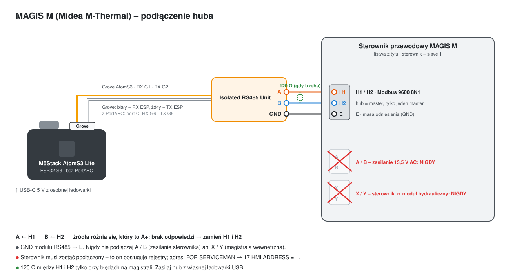

# Pompy ciepła MAGIS M (Midea M-Thermal) – pakiety mt_

[English](magis-m-midea.md) · **Polski**

Powrót do [przeglądu protokołów](../README.pl.md).

> **Eksperymentalne – jeszcze nie testowane na MAGIS M.** Pakiety implementują protokół Modbus Midea M-Thermal, na
> którym zbudowany jest MAGIS M. Masz taką pompę – zgłoś, co widzisz (patrz [Zbieranie logów](collecting-logs.pl.md)).

Immergas **MAGIS M** (M4 – M30, R32) to pompa Midea M-Thermal: panel przewodowy z portem Modbus H1 / H2, w menu nazwy
T1S / T4 / T5 / IBH / TBH. Nie ma nic wspólnego z MAGIS PRO / COMBO V2 na Samsungu, które obsługuje reszta huba.
**MAGIS M TOP** (R290, E-BOX TOP) to jeszcze co innego: jego port BMS mówi protokołem BMS generatora Immergasa – patrz
[Kotły gazowe po Modbus BMS](gas-boiler-bms.pl.md) (pakiet `gb_mtop`).

## Sprzęt

| Element | |
|---|---|
| [M5Stack AtomS3 Lite](https://docs.m5stack.com/en/core/AtomS3%20Lite) | ESP32-S3; moduł RS485 w jego własnym gnieździe Grove (RX GPIO1, TX GPIO2) – przy jednej magistrali **ATOMIC PortABC nie jest potrzebny** (z PortABC: port C, RX GPIO6, TX GPIO5) |
| 1× M5Stack Isolated RS485 Unit | izolacja galwaniczna, automatyczny kierunek (bez pinu DE) |

Działa każdy ESP32 z transceiverem RS485 (`mt_uart_rx_pin` / `mt_uart_tx_pin`).

## Podłączenie

| Hub (RS485) | Panel przewodowy | Uwagi |
|---|---|---|
| A / B | **H1 / H2** | źródła różnią się, który to A+ – brak odpowiedzi: zamień; może być potrzebny rezystor 120 Ω między H1 i H2 |
| GND | **E** | odniesienie |
| – | ~~A / B~~ | **nigdy**: zasilanie panelu 13,5 V AC |
| – | ~~X / Y~~ | **nigdy**: wewnętrzna magistrala panel ↔ moduł hydrauliczny |

Hub jest masterem, panel slave'em: **9600 bodów, 8N1, adres 1** (menu panelu *FOR SERVICEMAN → 17 HMI ADDRESS*).
Na H1 / H2 tylko jeden master, a panel musi zostać podłączony – to on podaje rejestry.



## Instalacja

> 📄 **Plik konfiguracji: [`examples/immergas-magis-m.yaml`](../examples/immergas-magis-m.yaml)**
> ([otwórz na GitHubie](https://github.com/jotuera/immergas-modbus-bms-nasa-opentherm-hub/blob/main/examples/immergas-magis-m.yaml) · [pobierz (raw)](https://raw.githubusercontent.com/jotuera/immergas-modbus-bms-nasa-opentherm-hub/main/examples/immergas-magis-m.yaml))

1. **Skopiuj konfigurację.** Zapisz [`immergas-magis-m.yaml`](../examples/immergas-magis-m.yaml) w folderze ESPHome (w Home Assistant: *ESPHome →
   Nowe urządzenie → Kontynuuj → Pomiń*, a potem wklej treść do nowego pliku).
2. **Dodaj sekrety**, których używa, do `secrets.yaml`: `wifi_ssid`, `wifi_password`, `immergas_magis_m_api_key`, `immergas_magis_m_ota_password`.
3. **Wybierz, czego potrzebujesz** w bloku `packages:` na końcu pliku:

   ```yaml
   files:
     - packages/lang/mt_en.yaml        # albo mt_pl / _cs / _de / _es / _fr / _hu / _it / _nl / _pt / _sk
     - packages/mt_core.yaml
     - packages/mt_status.yaml
     - packages/mt_sensors.yaml
     - packages/mt_energy.yaml
     - packages/mt_control.yaml
     - packages/mt_params.yaml         # opcjonalnie: parametry instalatora, tylko odczyt
   ```

   - Zacznij od wszystkich pakietów; na pierwsze uruchomienie tylko z odczytem pomiń `mt_control`.
   - `mt_energy_multiply` (podstawienie), jeśli liczniki energii wychodzą 100× za małe.
4. **Sprawdź piny** (`substitutions:` na górze), jeśli twoja płytka to nie AtomS3 Lite z modułem w gnieździe Grove.
5. **Wgraj** urządzenie (pierwszy raz przez USB, potem przez sieć) i **dodaj je w Home Assistant** (*Ustawienia →
   Urządzenia i usługi* – znajdzie się samo).
6. **Sprawdź połączenie:** *Immergas M - Wersja protokołu* i *Temperatura wody na wylocie* dostają wartości w ciągu minuty. Nic = zamień H1 / H2, sprawdź rezystor 120 Ω i adres panelu (menu 17).

**Przed jakąkolwiek zmianą poczekaj na pierwsze odczyty** – przełączniki wł. / wył. i funkcji zmieniają pojedyncze
bity wspólnych rejestrów i korzystają z ostatniej odczytanej wartości.

## Pakiety

| Pakiet | Co daje |
|---|---|
| `mt_core` | UART / Modbus, przełącznik *Połączenie Modbus*, wersja protokołu (187), flaga rozdzielczości czujników (189 bit8: 1 °C albo 0,1 °C), pomocnik zapisu |
| `mt_status` | bieżący tryb, bieżący i trzy ostatnie błędy (z kodem błędu i jego opisem), odszranianie / ochrona przed zamarzaniem / powrót oleju / termostat / SG / EVU, grzałki IBH1 / IBH2 / TBH, pompy, zawór 3-drogowy, alarm, praca, wersje oprogramowania |
| `mt_sensors` | częstotliwość i docelowa częstotliwość sprężarki, wentylator, zawór rozprężny, woda wlot / wylot / całkowita, temp. zewnętrzna, pokoju, zasobnika CWU, temperatury czynnika, ciśnienia, prąd i napięcie jednostki zewn., bufor, godziny sprężarki, zasilanie z krzywej, przepływ wody, moc cieplna |
| `mt_energy` | liczniki energii elektrycznej i cieplnej, moc grzewcza i pobór, COP jednostki i własny COP huba |
| `mt_stats` (opcjonalny) | energia cieplna i elektryczna dziś, COP dziś, starty i czas pracy sprężarki dziś – liczone w hubie, zerowane o północy (czas z Home Assistant) |
| `mt_programs` (opcjonalny, z `mt_stats`) | programy liczone w hubie: program CO AUTO (4 kalendarze × 4 zakresy, kalendarz na każdy dzień; Komfort / Eko jako zadana pokoju przy sterowaniu wg temp. pokoju, inaczej Eko obniża nastawę wody strefy 1 albo wyłącza strefę 1), program CWU (Komfort / Eko), tryb wyjazdowy (strefa 1 i CWU wył. albo tylko strefa 1, do daty), automatyczne Lato / Zima (strefa 1 wł. / wył. wg średniej zewnętrznej 24 h); dezynfekcję robi sama jednostka |
| `mt_unit_params` (opcjonalny, z `mt_stats`) | przypomnienie o przeglądzie (ostatni przegląd, interwał, przegląd wykonany, termin); karty pokazują parametry instalatora z `mt_params` (tylko odczyt) jako Parametry jednostki (offline) |
| `mt_costs` (opcjonalny, z `mt_energy`) | cena prądu i pojemność zasobnika CWU (trzymane w hubie), koszt ciepła z pompy (cena ÷ COP) i ostatni cykl CWU – źródło, czas, prąd, ciepło z zasobnika i z przepływu, oba COP, koszt i to samo ciepło z grzałki; dla kart *Pompa czy grzałka?* i *Ostatni cykl CWU* |
| `mt_computed` (opcjonalny) | delta T wody, lift termiczny, średnia obiegu, moc cieplna z przepływu, odchyłka od krzywej, rozwarstwienie bufora; temperatura skraplania / parowania z ciśnień (`mt_refrigerant`: R32 / R290, `mt_pressure_offset_kpa`: 0 ciśnienie bezwzględne / 101 względne), przegrzanie ssania, dochłodzenie, przegrzanie tłoczenia, stopień sprężania, moc jednostki zewn. z U × I; *Stan pracy* jako jeden tekst |
| `mt_analytics` (opcjonalny, z `mt_stats`) | dziś: średni / ostatni cykl sprężarki i krótkie cykle, odszraniania (liczba, czas ostatniego, minuty od), czas sprężarki, prąd, ciepło i COP osobno dla grzania i CWU, COP od początku, czas pracy IBH / TBH i ich szacowany prąd (`mt_ibh1_kw`, `mt_ibh2_kw`, `mt_tbh_kw`), COP systemu z grzałkami; dla karty *Dziś · analiza pracy* |
| `mt_busmap` (opcjonalny) | skaner rejestrów dla karty Mapa magistral: czyta po kolei rejestry holding 0–299 (kilka minut) i zostawia te, które odpowiadają, a żaden pakiet mt_ ich nie czyta; *Zgłoś mapę magistrali* robi z nich gotowe zgłoszenie na GitHubie |
| `mt_control` | wł. / wył. strefa 1 / strefa 2 / CWU / wg pokoju, tryb pracy (auto / chłodzenie / grzanie), nastawy wody strefy 1 / 2, nastawa pokoju i CWU, krzywa pogodowa wł. / numer, tryb cichy, ECO, dezynfekcja, wymuszona CWU / grzałka zasobnika / grzałka IBH |
| `mt_params` (opcjonalny) | tylko odczyt: limity nastaw, limity temp. zewn. dla grzania, krzywa własna |
| `lang/mt_en`, `lang/mt_pl` | nazwy encji (`mt_name_prefix`, domyślnie „Immergas M”) |

Plik konfiguracji i kroki są w sekcji [Instalacja](#instalacja).

## Mapa rejestrów (holding, funkcja 0x03 / 0x06)

| Rejestr | Znaczenie | Uwagi |
|---|---|---|
| 0 | wł. / wył.: bit0 wg pokoju, bit1 strefa 1, bit2 CWU, bit3 strefa 2 | pole bitowe – hub zmienia tylko swój bit |
| 1 | tryb: 1 auto, 2 chłodzenie, 3 grzanie | |
| 2 | nastawa wody: młodszy bajt strefa 1, starszy strefa 2 | °C albo °C × 2 przy rozdzielczości 0,1 °C |
| 3 | nastawa pokoju | °C × 2 |
| 4 | nastawa CWU | °C |
| 5 | funkcje: bit4 dezynfekcja, bit6 tryb cichy, bit10 ECO, bit12 / bit13 krzywa strefa 1 / 2 | pole bitowe |
| 6 | numer krzywej: młodszy bajt strefa 1, starszy strefa 2 | 1–9 (9 = własna) |
| 7 / 8 / 9 | wymuszona CWU / grzałka zasobnika TBH / grzałka IBH | 0 wg programu, 1 wł., 2 wył. |
| 100 / 132 | częstotliwość / docelowa częstotliwość sprężarki | Hz |
| 101 / 199 | bieżący tryb | 199: 0 wył., 2 chłodzenie, 3 grzanie, 5 CWU |
| 102 / 103 | obroty wentylatora / zawór rozprężny | rpm / kroki |
| 104 / 105 / 110 / 111 | woda wlot / wylot / całkowita / strefa 2 | flaga rozdzielczości |
| 106 / 108 / 109 / 112 / 113 | T3 wymiennik, tłoczenie, ssanie, T2 ciecz, T2B gaz | flaga rozdzielczości |
| 107 / 114 / 115 | zewnętrzna (T4) / pokój / zasobnik CWU (T5) | flaga rozdzielczości |
| 116 / 117 | ciśnienie wysokie / niskie | kPa (starszy protokół × 10) |
| 118 / 119 | prąd / napięcie jednostki zewnętrznej | A / V |
| 120 / 121 | bufor góra / dół | |
| 122 / 123 | godziny sprężarki / moc jednostki | h / kW |
| 124–127 | bieżący błąd, trzy ostatnie | kod |
| 128 | bity stanu: 1 odszranianie, 2 ochrona przed zamarzaniem, 3 powrót oleju, 4 zdalne, 6 / 7 termostat grzanie / chłodzenie, 10 SG, 11 EVU | |
| 129 | wyjścia: 0 IBH1, 1 IBH2, 2 TBH, 3 pompa wewn., 4 SV1, 6 pompa zewn., 12 alarm, 13 praca | |
| 130 / 131 | oprogramowanie jednostki wewn. / panelu | |
| 135 | temperatura modułu inwertera | °C |
| 136 / 137 | zasilanie z krzywej strefa 1 / 2 | |
| 138 | przepływ wody | 0,01 m³/h (pokazywany w l/min) |
| 140 | moc cieplna | 0,01 kW |
| 143–144 / 145–146 | energia elektryczna / cieplna (słowo starsze, młodsze) | domyślnie 0,01 kWh (`mt_energy_multiply`) |
| 148 / 150 / 151 | moc grzewcza / pobór / COP | 0,01 (protokół V4.6+) |
| 187 / 189 | wersja protokołu / status 2 (bit8 = rozdzielczość 0,1 °C) | |
| 201–208 | limity nastaw (chłodzenie, grzanie, CWU) | czytane pojedynczo |
| 231 / 232 | grzanie – maks. / min. temp. zewn. | |
| 265–268 | krzywa własna: zasilanie zimny / ciepły punkt, temp. zewn. zimny / ciepły punkt | |

**Do potwierdzenia na MAGIS M:** polaryzacja H1 / H2, jednostka liczników energii, skala ciśnień w danej wersji
protokołu, czy nastawy rejestru 2 idą za flagą rozdzielczości i numeracja kodów błędów (pokazywana jako liczba).
Parametrów instalatora od 209 w górę celowo się nie zapisuje.

## Kody błędów

Panel pokazuje kod (E8, P0, H0 …); rejestry Modbus **124** (bieżący błąd) i **125–127** (trzy ostatnie) podają jego
**numer** – kolumnę *supervision system error code* z instrukcji MAGIS M (rozdz. 13.4), tę samą numerację co w Midea
M-Thermal. Hub pokazuje *Błąd* jako `E8: <opis>`, a *Ostatnie błędy* jako kody (`E8 · P0 · -`). Opisy są własnymi,
krótkimi sformułowaniami projektu (11 języków, język z `lang/mt_xx`) – pełne czynności naprawcze są w instrukcji.

| Numer | Kod | Znaczenie i co sprawdzić |
|---|---|---|
| 1 | **E0** | Brak przepływu wody (trzy razy E8). Sprawdź przepływomierz, jego okablowanie i przepływ wody. |
| 2 | **E1** | Brak fazy lub zła kolejność faz (jednostki 3-fazowe). Sprawdź przewody zasilania; zamień dwie fazy. |
| 3 | **E2** | Brak komunikacji panelu z modułem hydraulicznym. Sprawdź przewód panelu i kolejność żył; odsuń go od zakłóceń. |
| 4 | **E3** | Usterka czujnika: końcowa temperatura zasilania (T1). Sprawdź czujnik, jego rezystancję i złącze (osusz, jeśli mokre); wymień uszkodzony. |
| 5 | **E4** | Usterka czujnika: zasobnik CWU (T5). Sprawdź czujnik, jego rezystancję i złącze (osusz, jeśli mokre); wymień uszkodzony. |
| 6 | **E5** | Usterka czujnika: czynnik na wyjściu skraplacza (T3). Sprawdź czujnik, jego rezystancję i złącze (osusz, jeśli mokre); wymień uszkodzony. |
| 7 | **E6** | Usterka czujnika: temperatura otoczenia (T4). Sprawdź czujnik, jego rezystancję i złącze (osusz, jeśli mokre); wymień uszkodzony. |
| 8 | **E7** | Usterka czujnika: bufor (Tbt1). Sprawdź czujnik, jego rezystancję i złącze (osusz, jeśli mokre); wymień uszkodzony. |
| 9 | **E8** | Za mały przepływ wody. Otwórz zawory, wyczyść filtr, odpowietrz, sprawdź ciśnienie (powyżej 1 bar), prędkość pompy i naczynie wzbiorcze. |
| 10 | **E9** | Usterka czujnika: ssanie sprężarki (Th). Sprawdź czujnik, jego rezystancję i złącze (osusz, jeśli mokre); wymień uszkodzony. |
| 11 | **EA** | Usterka czujnika: tłoczenie sprężarki (Tp). Sprawdź czujnik, jego rezystancję i złącze (osusz, jeśli mokre); wymień uszkodzony. |
| 12 | **Eb** | Usterka czujnika: kolektor słoneczny (Tsolar). Sprawdź czujnik, jego rezystancję i złącze (osusz, jeśli mokre); wymień uszkodzony. |
| 13 | **EC** | Usterka czujnika: dół bufora / rozdzielacz (Tbt2). Sprawdź czujnik, jego rezystancję i złącze (osusz, jeśli mokre); wymień uszkodzony. |
| 14 | **Ed** | Usterka czujnika: woda na wejściu wymiennika płytowego (Tw_in). Sprawdź czujnik, jego rezystancję i złącze (osusz, jeśli mokre); wymień uszkodzony. |
| 15 | **EE** | Błąd pamięci EEPROM płyty modułu hydraulicznego. Wezwij serwis. |
| 19 | **EP** | Upływ na grzałce zasobnika (TBH). Sprawdź urządzenie na wyjściu TBH. |
| 20 | **P0** | Zabezpieczenie niskiego ciśnienia: brak czynnika, brudny lub zasłonięty wymiennik zewnętrzny, mały przepływ przy chłodzeniu albo zablokowany zawór rozprężny. Wezwij serwis. |
| 21 | **P1** | Zabezpieczenie wysokiego ciśnienia: mały przepływ, powietrze w instalacji albo za niskie ciśnienie wody (trzymaj 1,5-2 bar); przy chłodzeniu brudny lub zasłonięty wymiennik. |
| 23 | **P3** | Przeciążenie prądowe sprężarki. Przyczyny jak przy P1 albo za niskie napięcie zasilania. |
| 24 | **P4** | Za wysoka temperatura tłoczenia sprężarki. Przyczyny jak przy P1, brak czynnika albo luźny czujnik Tw_out / T1 / T5. |
| 25 | **P5** | Za duża różnica temperatur wody na wymienniku płytowym (Tw_out - Tw_in). Sprawdź zawory, filtr, odpowietrzenie i pompę. |
| 26 | **P6** | Zabezpieczenie modułu inwertera: za niskie napięcie, za mało miejsca wokół jednostki, brudny wymiennik albo stojący wentylator. |
| 29 | **P9** | Zabezpieczenie wentylatora. Sprawdź wentylator i jego silnik. |
| 31 | **Pb** | Ochrona przed zamarzaniem. Jednostka sama wraca do normalnej pracy. |
| 33 | **Pd** | Za wysoka temperatura czynnika na wyjściu skraplacza (chłodzenie): brudny lub zasłonięty wymiennik, za mało miejsca wokół jednostki albo usterka wentylatora. |
| 38 | **PP** | Woda na wejściu cieplejsza niż na wyjściu przy grzaniu (Tw_in > Tw_out). Sprawdź oba czujniki i ich położenie; przyczyną może być zablokowany zawór 4-drogowy. |
| 39 | **H0** | Brak komunikacji płyty modułu hydraulicznego z płytą główną PCB B. Sprawdź przewód i kolejność żył; odsuń go od zakłóceń. |
| 40 | **H1** | Brak komunikacji modułu inwertera (PCB A) z płytą główną (PCB B). Sprawdź zasilanie obu płyt i przewód między nimi. |
| 41 | **H2** | Usterka czujnika: czynnik na wymienniku płytowym, rura cieczowa (T2). Sprawdź czujnik, jego rezystancję i złącze (osusz, jeśli mokre); wymień uszkodzony. |
| 42 | **H3** | Usterka czujnika: czynnik na wymienniku płytowym, rura gazowa (T2B). Sprawdź czujnik, jego rezystancję i złącze (osusz, jeśli mokre); wymień uszkodzony. |
| 43 | **H4** | P6 (L0 / L1) wystąpił trzy razy w ciągu godziny. Zobacz L0 i L1. |
| 44 | **H5** | Usterka czujnika temperatury pokoju (Ta) w panelu. Wymień czujnik lub panel albo podłącz Ta do płyty modułu hydraulicznego. |
| 45 | **H6** | Usterka silnika wentylatora: silny wiatr na wentylator albo uszkodzony silnik. |
| 46 | **H7** | Zabezpieczenie napięcia obwodu głównego. Sprawdź zasilanie; nie włączaj i nie wyłączaj szybko (odczekaj 3 min). Jeśli wraca, płyta główna jest uszkodzona. |
| 47 | **H8** | Usterka czujnika ciśnienia. Sprawdź jego złącze; wymień uszkodzony czujnik. |
| 48 | **H9** | Usterka czujnika: woda strefy 2 (Tw2). Sprawdź czujnik, jego rezystancję i złącze (osusz, jeśli mokre); wymień uszkodzony. |
| 49 | **HA** | Usterka czujnika: woda na wyjściu (Tw_out). Sprawdź czujnik, jego rezystancję i złącze (osusz, jeśli mokre); wymień uszkodzony. |
| 50 | **Hb** | PP wystąpił trzy razy przy wodzie na wyjściu poniżej 7 °C. Zobacz PP. |
| 52 | **Hd** | Brak komunikacji jednostek w kaskadzie (master / slave) albo więcej niż jedna jednostka na panelu. Sprawdź przewody sygnałowe i uruchom ponownie. |
| 53 | **HE** | Brak komunikacji z płytką przekaźnikową termostatu, choć w panelu RT/Ta PCB jest włączone. Podłącz płytkę albo wyłącz RT/Ta PCB. |
| 54 | **HF** | Błąd pamięci EEPROM płyty modułu inwertera. Wezwij serwis. |
| 55 | **HH** | H6 wystąpił dziesięć razy w ciągu dwóch godzin. Zobacz H6. |
| 57 | **HP** | Zabezpieczenie niskiego ciśnienia przy chłodzeniu (poniżej 0,6 MPa) trzy razy w ciągu godziny. Zobacz P0. |
| 65 | **C7** | Za gorący moduł inwertera: za niskie napięcie, za mało miejsca wokół jednostki, brudny wymiennik albo stojący wentylator. |
| 116 | **F1** | Za niskie napięcie szyny DC. Sprawdź zasilanie; jeśli jest dobre, uszkodzona jest płyta główna lub inwertera. Wezwij serwis. |
| 134 | **L0** | Usterka modułu inwertera sprężarki. Sprawdź ciśnienie w układzie, uzwojenia sprężarki i przewody U / V / W oraz L1-L3. Wezwij serwis. |
| 135 | **L1** | Zabezpieczenie przed zbyt niskim napięciem szyny DC. Sprawdź napięcie zasilania. |
| 136 | **L2** | Zabezpieczenie przed zbyt wysokim napięciem szyny DC. Sprawdź napięcie zasilania. |
| 138 | **L4** | Usterka sterowania sprężarki (MCE). Wezwij serwis. |
| 139 | **L5** | Zabezpieczenie zerowej prędkości sprężarki. Wezwij serwis. |
| 141 | **L7** | Zła kolejność faz (jednostki 3-fazowe). Zamień dwie fazy zasilania. |
| 142 | **L8** | Prędkość sprężarki zmieniła się o ponad 15 Hz w ciągu sekundy. Wezwij serwis. |
| 143 | **L9** | Prędkość sprężarki różni się od zadanej o ponad 15 Hz. Wezwij serwis. |

## Baza wiedzy

- Protokół Modbus Midea M-Thermal panelu przewodowego (rodzina KJR-120) – mapa rejestrów powyżej; wersja protokołu
  (187) i flaga rozdzielczości (189) mówią, który wariant ma dana jednostka.
- Instrukcja instalatora MAGIS M ST006126a: zaciski panelu A B X Y E i H1 / H2 / E, menu *FOR SERVICEMAN → 17 HMI
  ADDRESS SET*, parametry T1S / T4 / T5 / IBH / TBH.
- Projekty społeczności dla klonów Midea M-Thermal (tylko jako odniesienie dla adresów i skal):
  [Mosibi/Midea-heat-pump-ESPHome](https://github.com/Mosibi/Midea-heat-pump-ESPHome), wątki na forum Home Assistant
  o klonach Midea od Immergasa.
