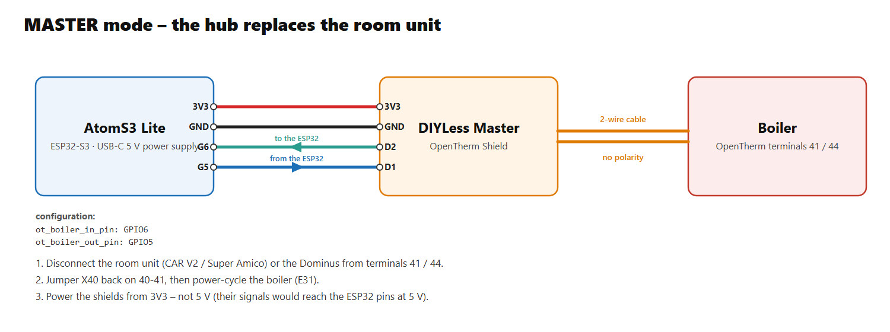
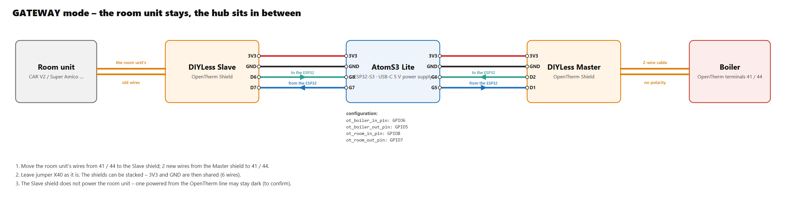
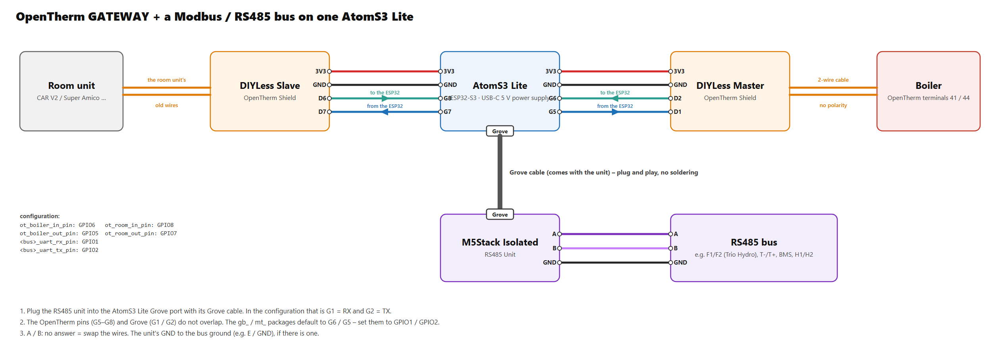

# OpenTherm boilers in the hub (immergas_ot)

**English** · [Polski](opentherm-hub.pl.md)

Back to the [protocol overview](../README.md).

> **Experimental – not tested on a boiler yet.** Written from the OpenTherm 2.2 specification and what the
> [Immergas Dominus integration](https://github.com/jotuera/immergas-dominus/blob/main/docs/opentherm.md) found on
> Immergas boilers. The frame codec is tested on a PC (exact timing, ±10 % bit rate, jitter, spikes, parity).

Immergas boilers without Modbus (VICTRIX ZEUS, EXA, TERA, OMNIA, HERCULES Condensing …) talk OpenTherm to their room
unit (CAR V2, Super Amico) or to the Dominus module. The `immergas_ot` component lets the hub take that place – or sit
in the middle.

## In short

| | Master – the hub replaces the room unit | Gateway – the room unit stays |
|---|---|---|
| **Buy** | M5Stack AtomS3 Lite + **DIYLess Master OpenTherm Shield** + 4 jumper wires | the same + **DIYLess Slave OpenTherm Shield** (6 wires, the shields stacked) |
| **Connect** | Master shield → boiler OpenTherm terminals (**41 / 44** on most Immergas boilers) | room unit wires → Slave shield, Master shield → boiler 41 / 44 |
| **Flash** | [`examples/immergas-opentherm.yaml`](../examples/immergas-opentherm.yaml) as it is | the same file, uncomment `ot_gateway` and the room pins |
| **On the boiler** | remove the CAR V2, jumper X40 back on 40-41, power-cycle (E31) | nothing to change |

Details: [Hardware](#hardware), [Wiring](#wiring) with diagrams, [Installation](#installation).

## Two modes

| Mode | Wiring | What happens |
|---|---|---|
| **master** (default) | master adapter → boiler | the hub **replaces** the CAR V2 / Super Amico / Dominus: it sends the status (Data-ID 0) with CH / DHW enable, the CH flow setpoint (1) every cycle, the DHW setpoint (56), max. CH (57) and max. modulation (14) again and again, and reads the rest round robin |
| **gateway** | slave adapter ← room unit, master adapter → boiler | the room unit **stays**: every request is passed to the boiler and the answer back; the hub sees all of it, may **override** selected writes (CH setpoint, DHW setpoint, max. modulation, CH / DHW enable), answers the reads the boiler does not know itself and uses those slots for its own reads; when the room unit is silent for 8 s the hub runs the boiler itself (**standalone**) until it is back |

## Hardware

OpenTherm is a 2-wire current / voltage loop – **not** RS485, so the M5Stack RS485 units do not fit. M5Stack makes no
OpenTherm unit; the hub uses the **DIYLess** shields (or another OpenTherm adapter with the same logic):

| Part | Master | Gateway |
|---|---|---|
| [M5Stack AtomS3 Lite](https://docs.m5stack.com/en/core/AtomS3%20Lite) (ESP32-S3), USB-C 5 V power supply | ✔ | ✔ |
| [DIYLess Master OpenTherm Shield](https://diyless.com/product/master-opentherm-shield) – talks to the **boiler** | ✔ | ✔ |
| [DIYLess Slave OpenTherm Shield](https://diyless.com/product/slave-opentherm-shield) – talks to the **room unit** | – | ✔ |
| female–female jumper wires (Dupont), 2-wire cable to the boiler | 4 wires | 6 wires |
| a small plastic box | ✔ | ✔ |

Two ways to build it:

- **A – AtomS3 Lite + shields on jumper wires (recommended, the default pins).** The shields are made for a WeMos D1
  mini, but they are just a header with 3V3, GND and two signals each – wire them to the AtomS3 Lite header pins. No
  ATOMIC PortABC needed. For the gateway stack the Slave shield on the Master shield (both are stackable) and wire the
  stack once.
- **B – DIYLess only: the shields stacked on a WeMos D1 mini ESP32** (or the
  [DIYLess ESP OpenTherm Gateway](https://diyless.com/product/esp8266-opentherm-gateway) kit). No wires at all; change
  the board and the pins in the configuration (see [Installation](#installation), step 4).

**Power the shields from 3V3, not 5 V.** They take 3.3 V or 5 V and their signals follow the supply – 5 V signals
would go into the 3.3 V ESP32 pins. The shields make the OpenTherm line voltage themselves, no extra supply.

The logic of the DIYLess shields (and of most adapters built on the OpenTherm library by Ihor Melnyk): output LOW =
line active, input HIGH = line active – the defaults `out_active_low: true`, `in_active_low: false`. Change them only
for an adapter that works the other way.

## Wiring

> ⚠️ **Check the protocol first – not every Immergas remote bus is OpenTherm.** The CAR V2 speaks two protocols and
> shows which one in its information menu: **VER PI** = **IMG-BUS** (OpenTherm with minor changes – works) or **VER PC**
> = **CAR-BUS** (an older Immergas protocol – **no OpenTherm master can talk to it**, whatever the adapter or the 0xCA
> byte). Without a CAR V2 measure the remote terminals with nothing connected: **up to about 18 V DC = IMG-BUS**,
> **about 24–35 V DC (e.g. 28 V) = CAR-BUS**. Reported CAR-BUS boiler: VICTRIX TT. On a TERA the boiler may also wait
> for the CAR V2 until **P7 = 2** (third-party remote) is set and the boiler power-cycled – not confirmed yet.
> Source: [OTGateway #284](https://github.com/Laxilef/OTGateway/issues/284), CAR V2 manual 1.038958 (technical data).
>
> An IMG-BUS boiler can also be reached over Modbus through the Immergas **IU23** interface – see
> [Gas boilers over Modbus BMS](gas-boiler-bms.md) (`gb_iu23`, hypothesis).

OpenTherm has no polarity. The Master shield goes on the boiler's OpenTherm terminals (where the CAR V2 / Dominus
was), the Slave shield (gateway) on the room unit's two wires.

| Boiler family | OpenTherm terminals | Without the room unit |
|---|---|---|
| VICTRIX ZEUS 25, EXA, TERA, OMNIA | 41 / 44 | jumper X40 back on 40-41, power-cycle (E31); TERA: P7 = 2 for a third-party master |
| VICTRIX ZEUS Superior 26 / 32, HERCULES Condensing / Solar 26 | 41 / 44 (IMG BUS) | confirmed on a ZEUS Superior 26 2 ErP; 42 / 43 are the Super CAR terminals, not OpenTherm; HERCULES not confirmed yet. X40 back; M3 P33 = ON keeps CH working after E31 |

### Shield → AtomS3 Lite (build A)

The pins of the shields are named by their place on the D1 mini header. **In / out** in the configuration are seen
from the ESP32: the boiler's answer comes **in**, the hub's frames go **out**.

| Shield pin (D1 mini header) | AtomS3 Lite header | Configuration |
|---|---|---|
| Master **3V3** | **3V3** | |
| Master **GND** | **G** (GND) | |
| Master **D2** – signal to the ESP32 | **G6** | `ot_boiler_in_pin: GPIO6` |
| Master **D1** – signal from the ESP32 | **G5** | `ot_boiler_out_pin: GPIO5` |
| Slave **D6** – signal to the ESP32 (gateway) | **G8** | `ot_room_in_pin: GPIO8` |
| Slave **D7** – signal from the ESP32 (gateway) | **G7** | `ot_room_out_pin: GPIO7` |

Stacked, the Slave shield shares 3V3 and GND with the Master, so the gateway needs 6 wires. The pin pairs are those of
the gateway example of the OpenTherm library the shields are made for (master D2 / D1, slave D6 / D7; on a D1 mini ESP32
GPIO21 / 22 and GPIO19 / 23).

### Master – the hub replaces the room unit



1. Switch the boiler off. Disconnect the room unit (CAR V2 / Super Amico) or the Dominus from the OpenTherm terminals.
2. Two wires from the Master shield terminal to the boiler's OpenTherm terminals (table above) – any polarity.
3. Put jumper X40 back on 40-41 (see the table), then power the hub and the boiler.

### Gateway – the room unit stays




1. Switch the boiler off. Take the room unit's two wires off the boiler's OpenTherm terminals and put them on the
   Slave shield terminal.
2. Two new wires from the Master shield terminal to the boiler's OpenTherm terminals.
3. Leave jumper X40 as it was – the room unit is still there, through the hub. Power the hub and the boiler.

> **Room units powered from the OpenTherm line:** the DIYLess Slave shield supports the low power mode only – it cannot
> power a room unit. A room unit that takes its power from the boiler's two wires may stay dark behind it; battery or
> mains-powered room units are fine. Whether the CAR V2 / Super Amico start behind the gateway is not confirmed yet –
> please report it.

### Together with an RS485 bus on one AtomS3 Lite

The OpenTherm shields use the header pins G5–G8, so the AtomS3 Lite Grove port stays free for an M5Stack Isolated RS485
Unit – e.g. Samsung NASA F1/F2 (TRIO HYDRO) or a Modbus BMS next to the OpenTherm boiler. Set that bus's
`*_uart_rx_pin: GPIO1` / `*_uart_tx_pin: GPIO2` (the `gb_` / `mt_` packages default to G6 / G5, which OpenTherm uses).



## Installation

> 📄 **Configuration file: [`examples/immergas-opentherm.yaml`](../examples/immergas-opentherm.yaml)**
> ([open on GitHub](https://github.com/jotuera/immergas-modbus-bms-nasa-opentherm-hub/blob/main/examples/immergas-opentherm.yaml) · [download (raw)](https://raw.githubusercontent.com/jotuera/immergas-modbus-bms-nasa-opentherm-hub/main/examples/immergas-opentherm.yaml))

**Before switching to master** remove the room unit (CAR V2 / Super Amico) or disconnect the Dominus from the OpenTherm
terminals, put jumper X40 back on 40-41 and power-cycle the boiler (E31). On the HERCULES / ZEUS Superior 26 / 32
family set M3 P33 = ON first – the boiler then keeps heating even if OpenTherm is lost.

1. **Copy the configuration.** Save [`immergas-opentherm.yaml`](../examples/immergas-opentherm.yaml) into your ESPHome folder (in Home Assistant:
   *ESPHome → New device → Continue → Skip*, then paste its content into the new file).
2. **Add the secrets** it uses to `secrets.yaml`: `wifi_ssid`, `wifi_password`, `immergas_ot_api_key`, `immergas_ot_ota_password`.
3. **Pick what you need** in the `packages:` block at the end of the file:

   ```yaml
   files:
     - packages/lang/ot_en.yaml        # or ot_pl.yaml
     - packages/ot_core.yaml
     - packages/ot_sensors.yaml
     - packages/ot_control.yaml
     - packages/ot_regulator.yaml      # master: weather curve + room correction
     # - packages/ot_gateway.yaml      # gateway: the room unit stays
   ```

   - **Master** (the hub replaces the room unit): keep `ot_regulator` and set `ot_room_entity` to a room temperature
     sensor of Home Assistant (or leave it – the regulator then runs on the curve only).
   - **Gateway** (the room unit stays): uncomment `ot_gateway` and the `ot_room_in_pin` / `ot_room_out_pin`
     substitutions; `ot_regulator` is optional (it sets the values the hub uses while the room unit is silent).
4. **Check the pins** (`substitutions:` at the top). Build A keeps the defaults. Build B (shields on a WeMos D1 mini
   ESP32): `ot_boiler_in_pin: GPIO21`, `ot_boiler_out_pin: GPIO22`, gateway `ot_room_in_pin: GPIO19`,
   `ot_room_out_pin: GPIO23`; in `esp32:` set `board: wemos_d1_mini32` and remove `hardware_uart: USB_SERIAL_JTAG`
   from `logger:`.
5. **Flash** the device (USB the first time, then over the air) and **add it in Home Assistant** (*Settings → Devices
   & services* – it is found automatically).
6. **Check the connection:** *Immergas OT - Boiler connection* turns on within a few seconds and *Flow temperature* / *Flame* follow the boiler. *No answer* growing without *Frames OK* = check the adapter wiring and the `in_active_low` / `out_active_low` levels; in the gateway, *Room unit connection* shows the room unit.

## Packages

| Package | What it gives |
|---|---|
| `ot_core` | the component (master), boiler connection, frame / error / timeout counters, `ot_status_low_byte` (default **0xCA**, the "Immergas fix"), `ot_max_ch_follows_setpoint` (default **true**: 57 = CH setpoint), `ot_ch_off_setpoint` (default **10** °C, 0 = off), the **Data-ID map** (which IDs the boiler answers / does not know, 64 hex characters each) |
| `ot_sensors` | status (fault, CH, DHW, flame, diagnostic), fault flags and code (5), OEM code (115), flow, return, DHW, outdoor, exhaust, modulation, pressure, DHW flow, max. capacity / min. modulation (15), the setpoints the boiler uses (56 / 57), bounds (48 / 49), burner starts / hours |
| `ot_stats` (optional) | burner starts today, starts in the last hour (short cycling), burner time today – counted in the hub from the flame bit of every status frame, reset at midnight |
| `ot_computed` (optional) | delta T, mean loop temperature, flow minus the CH setpoint, exhaust minus return, *Condensing operation* (return below `ot_dew_point`, 55 °C), burner power in kW from the modulation (Data-ID 15 / 17, else `ot_boiler_kw`), OpenTherm link quality, lifetime burn per start and starts per burner hour, pressure drop over 24 h with *Possible leak* (`ot_leak_bar_day`, 0.2 bar), *Operating state* as one text |
| `ot_analytics` (optional, with `ot_stats` and `ot_computed`) | today: gas (heating / DHW) and a gas counter in m³ estimated from the burner power (`ot_gas_kwh_per_m3`, 10.6), gas price and cost, heat, condensing share, average modulation and the share at the minimum, average / last burn, short burns (`ot_short_burn_min`, 5), the last pause, DHW draws, the last draw, litres and DHW heat (`ot_cold_water`); for the *Today · boiler analysis* card |
| `ot_programs` (optional, with `ot_regulator`) | the programs of a CAR V2 / Dominus run in the hub: CH program AUTO (Comfort / Eco room target by 4 calendars × 4 ranges and a calendar per weekday), DHW program (Comfort / Eco DHW setpoint, own weekdays), anti-legionella (weekly / daily at 02:00, held 20 min), vacation (Standby / Summer until a date), automatic Summer / Winter by the 24 h outdoor mean, frost protection – they work without Home Assistant (only its time) |
| `ot_boiler_params` (optional) | the boiler menu copied once (OpenTherm does not carry it): menu family (ZEUS 25 / EXA / OMNIA, TERA, EXA 24 X / NIKE, ZEUS Superior 26 / 32, HERCULES) and its t / P / A or M1 / M3 / M5 values for the codes and hints of the cards (short cycling, TERA P7 = 2, HERCULES P33), the service reminder (CAR V2 MANUTZ) |
| `ot_control` | the **operating mode** (Standby / Summer / Winter / CH only), CH / DHW enable, CH flow setpoint, DHW setpoint, max. CH setpoint, max. modulation |
| `ot_regulator` (master) | weather curve (two points) + a slow room correction from a Home Assistant room temperature, CH on / off with a hysteresis – the regulator the room unit / Dominus would be |
| `ot_gateway` | gateway mode: room unit connection, standalone, what the room unit writes (CH setpoint, room setpoint and temperature, DHW setpoint, its CH / DHW enable), the override switches |
| `lang/ot_en`, `lang/ot_pl` | entity names (`ot_name_prefix`, default "Immergas OT") |

The configuration file and the steps are in [Installation](#installation).

## How it works

- **Frames**: 1000 bit/s Manchester, 34 bits; sent by a hardware timer (half bits), received by a GPIO interrupt and
  decoded by the timing of the mid-bit edges (bit rate off by up to ~20 % still decodes, spikes under 100 µs ignored).
- **Master cycle** (about 3 frames a second, at least 100 ms apart): status → CH setpoint → max. CH setpoint → a due
  write → a read.
  An ID the boiler answers UNKNOWN-DATAID / DATA-INVALID is skipped for an hour; its sensor shows unknown.
- **Writes repeat** – every OpenTherm master keeps sending its values (that is also why a value written past the CAR
  V2 does not stay); CH setpoint every cycle, DHW setpoint every 30 s, max. CH / modulation every minute.
- **Max. CH setpoint follows the CH setpoint** (`ot_max_ch_follows_setpoint`, default on). The original Immergas
  room unit sends, over and over: status with the low byte **0xCA** → read 48 → read 49 → write **1** → write 56 →
  write **57** with the same value as 1. Some Immergas boilers (EOLO Star, Mini EOLO) acknowledge Data-ID 1 and heat
  to Data-ID 57. So the hub writes 57 = the CH setpoint (kept within the boiler's bounds, Data-ID 49) every cycle;
  the "max. CH setpoint" number then caps the CH setpoint. Gateway: a 57 write of the room unit carries the CH
  setpoint it wrote; a room unit that never writes 57 gets it from the hub right after its own exchange (on a
  change and every 10 s). `false` = plain OpenTherm (57 = the number's own value).
- **CH off**: with the CH enable flag cleared the hub sends Data-ID 1 = `ot_ch_off_setpoint` (10 °C) – some boilers
  keep firing to the last flow setpoint with only the CH bit cleared; 57 keeps the real setpoint. 0 = keep sending
  the normal setpoint (a boiler that rejects a low value as invalid).
- **Modulation (Data-ID 17)** is read as unsigned 8.8 – it can go over 100 % during DHW and would wrap negative as
  signed f8.8 (`value_type: u88`).
- **Gateway timing**: the room unit expects the answer within 800 ms; the hub forwards a request at once and drops one
  older than 650 ms. Immergas boilers answer in a few tens of ms.

**Still to confirm on a boiler:** the adapters' levels with the hub, the 0xCA low byte with each family, how the CAR
V2 reacts to the gateway (it may use Immergas-specific IDs), and E31 when the hub takes over.

## Knowledge base

- [Immergas Dominus – OpenTherm](https://github.com/jotuera/immergas-dominus/blob/main/docs/opentherm.md): the
  Data-ID map read from Immergas boilers, the Immergas specifics (0xCA, E31, the cyclic DHW write, TSP and fault
  history), replacing the CAR V2, boilers and terminals, the menu profiles of the five boiler families.
- The OpenTherm 2.2 specification (physical layer, frame, Data-IDs).
- The sequence of the original room unit and the 0xCA byte: the arduino.ru thread "Термостат OpenTherm на ESP8266"
  (page 16, EOLO Star 24 E) and the Home Assistant community thread "OpenTherm component with Immergas EOLO Star
  24 boiler".
- Field reports of the OT-thing gateway (Home Assistant community thread "OT-thing – an OpenTherm WiFi gateway"):
  the CH off setpoint and the modulation above 100 %.
- Installer manuals of the boilers on immergas.pl (terminals, menu P / t / A / M, E31, P33, TERA P7).
