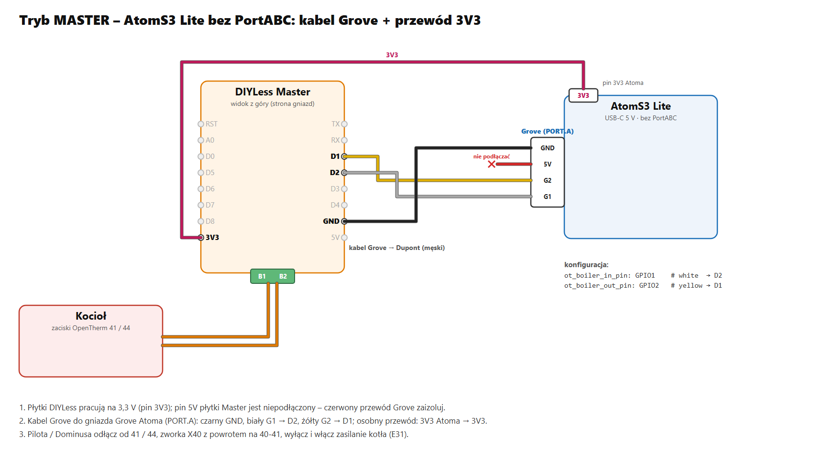
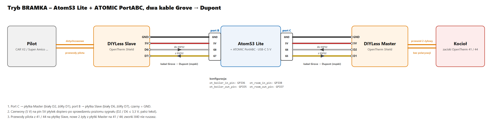

# Kotły OpenTherm w hubie (immergas_ot)

[English](opentherm-hub.md) · **Polski**

Powrót do [przeglądu protokołów](../README.pl.md).

> **Eksperymentalne – jeszcze nie testowane na kotle.** Napisane według specyfikacji OpenTherm 2.2 i tego, co
> [integracja Immergas Dominus](https://github.com/jotuera/immergas-dominus/blob/main/docs/opentherm.pl.md) ustaliła
> na kotłach Immergas. Kodek ramek jest przetestowany na PC (dokładny zegar, ±10 % prędkości, drgania, zakłócenia,
> parzystość).

Kotły Immergas bez Modbusa (VICTRIX ZEUS, EXA, TERA, OMNIA, HERCULES Condensing …) rozmawiają po OpenTherm ze swoim
pilotem (CAR V2, Super Amico) albo z modułem Dominus. Komponent `immergas_ot` pozwala hubowi zająć to miejsce – albo
stanąć pośrodku.

## W skrócie

| | Master – hub zastępuje pilota | Bramka – pilot zostaje |
|---|---|---|
| **Kup** | M5Stack AtomS3 Lite + **ATOMIC ToUnit Base** + **DIYLess Master OpenTherm Shield** + 2 żeńskie przewody Dupont na wtyk ToUnit (D1, D2) + 1 kabel Grove → Dupont (czarny GND, biały G1 = 3,3 V) | AtomS3 Lite + **ATOMIC PortABC** + **DIYLess Master** + **DIYLess Slave OpenTherm Shield** + 3 kable Grove → Dupont |
| **Podłącz** | ToUnit Base → D1 / D2 płytki Master (DIP 2 i 5 ON); gniazdo Grove AtomS3 → czarny GND, biały G1 = 3,3 V → 3V3; płytka Master → zaciski OpenTherm kotła (**41 / 44** w większości kotłów Immergas) | port A PortABC → Master: GND, D1, D2; port C → Slave: GND, 5V, D6, D7 (port B wolny na RS485); biały G1 gniazda Grove AtomS3 → 3V3 obu płytek; przewody pilota → płytka Slave, płytka Master → kocioł 41 / 44 |
| **Wgraj** | [`examples/immergas-opentherm.yaml`](../examples/immergas-opentherm.yaml) bez zmian | [`examples/immergas-opentherm-gateway.yaml`](../examples/immergas-opentherm-gateway.yaml) bez zmian |
| **Na kotle** | zdejmij CAR V2, zworka X40 z powrotem na 40-41, wyłącz i włącz zasilanie (E31) | nic nie zmieniasz |

Szczegóły: [Sprzęt](#sprzęt), [Podłączenie](#podłączenie) ze schematami, [Instalacja](#instalacja).

## Dwa tryby

| Tryb | Podłączenie | Co się dzieje |
|---|---|---|
| **master** (domyślny) | adapter master → kocioł | hub **zastępuje** CAR V2 / Super Amico / Dominusa: wysyła status (Data-ID 0) z zezwoleniem CO / CWU, nastawę zasilania CO (1) co cykl, nastawę CWU (56), maks. CO (57) i maks. modulację (14) raz po raz, a resztę czyta po kolei |
| **gateway** (bramka) | adapter slave ← pilot, adapter master → kocioł | pilot **zostaje**: każde żądanie idzie do kotła, a odpowiedź z powrotem; hub widzi wszystko, może **nadpisać** wybrane zapisy (nastawa CO, nastawa CWU, maks. modulacja, zezwolenia CO / CWU), sam odpowiada na odczyty, których kocioł nie zna, i wykorzystuje te sloty na własne odczyty; gdy pilot milczy 8 s, hub sam prowadzi kocioł (**standalone**), aż pilot wróci |

## Sprzęt

OpenTherm to dwuprzewodowa pętla prądowo-napięciowa – **nie** RS485, więc moduły RS485 M5Stack tu nie pasują. M5Stack
nie robi modułu OpenTherm; hub korzysta z płytek **DIYLess** (albo innego adaptera OpenTherm o tej samej logice):

| Element | Master | Bramka |
|---|---|---|
| [M5Stack AtomS3 Lite](https://docs.m5stack.com/en/core/AtomS3%20Lite) (ESP32-S3), zasilacz USB-C 5 V | ✔ | ✔ |
| [DIYLess Master OpenTherm Shield](https://diyless.com/product/master-opentherm-shield) – rozmawia z **kotłem** | ✔ | ✔ |
| [DIYLess Slave OpenTherm Shield](https://diyless.com/product/slave-opentherm-shield) – rozmawia z **pilotem** | – | ✔ |
| [M5Stack ATOMIC ToUnit Base](https://docs.m5stack.com/en/accessory/Atomic_ToUnit_Base) – męski wtyk HY2.0 (żeńskie przewody Dupont wpinasz prosto na piny, bez kabla Grove), sygnały wybierane przełącznikami DIP | ✔ | – |
| [M5Stack ATOMIC PortABC](https://botland.com.pl/seria-atom/23346-m5stack-atomic-portabc-extension-base-modul-rozszerzen-unit-do-modulow-deweloperskich-m5atom-m5stack-a130-6972934174567.html) – porty Grove A / B / C | – | ✔ |
| [kabel M5Stack Grove → Dupont](https://botland.com.pl/przewody-polaczeniowe-grove/21690-grove-zestaw-5-przewodow-4-pin-2mm-przewody-zenskiemeskie-254mm-20cm-6972934173751.html) (zestaw z Botlandu: 5 męskich + 5 żeńskich) – końcówki zależą od płytki: płytka Master zamówiona jako **soldered** (z przylutowanymi gniazdami) ma od góry gniazda żeńskie → końcówki **męskie**; płytka **goła** dostaje złącza, które lutujesz sam – piny męskie → końcówki **żeńskie**, gniazda żeńskie → końcówki męskie. Płytka Slave nie ma takiej opcji – sprawdź, jakie złącza ma Twoja | 1 | 2 |
| przewód 2-żyłowy do kotła, mała obudowa | ✔ | ✔ |

Jak to się składa:

- **Master (hub zastępuje pilota) – z ATOMIC ToUnit Base.** Jej męski wtyk przenosi dwa sygnały (żeńskie przewody Dupont wpięte prosto na niego): przełączniki DIP
  **2** (IO2 = G6, biały) i **5** (IO1 = G5, żółty) ON, reszta OFF. To domyślne piny.
- **Bramka (pilot zostaje) – zamiast niej ATOMIC PortABC:** **port A** = płytka Master (G39 / G38), **port C** =
  płytka Slave (G6 / G5), **port B** zostaje wolny na magistralę RS485 (G8 / G7).
- **Gniazdo Grove AtomS3** (własne gniazdo AtomS3 Lite przy USB-C) **daje 3,3 V**: jeszcze jeden kabel Grove →
  Dupont, jego biała żyła **G1 = 3,3 V** idzie do pinu 3V3 każdej płytki (pakiet `ot_3v3_supply`). Przy samym masterze
  jego czarna żyła to także **GND** płytki, a ToUnit Base przenosi tylko dwa sygnały. W bramce GND i sygnały dają
  porty A / C, a 5 V płytki Slave port C. Wszystko się wpina – bez lutowania i bez przewodów na bocznych pinach
  Atoma.

**Zasilanie: płytki pracują na 3,3 V (pin 3V3).** Widać to po ścieżkach płytek DIYLess: płytka Master używa tylko
D1, D2, GND i 3V3 (jej pin 5V jest niepodłączony), płytka Slave D6, D7, GND, 3V3 i 5V. Gniazda Grove (ToUnit Base,
PortABC, Grove AtomS3) dają GND, **5 V** i dwa GPIO – nie ma 3,3 V. Dlatego pin **G1 gniazda Grove AtomS3** trzyma
w stanie wysokim pakiet `ot_3v3_supply`, a jego biała żyła zasila pin 3V3 płytki (płytek); pin ESP32-S3 daje do ok.
40 mA, wystarczy na stronę logiki jednej lub dwóch płytek. Czerwone przewody 5 V przy płytce Master są nieużywane
(zaizoluj je); pin 5V płytki Slave dostaje czerwony przewód portu C.

Napięcie linii OpenTherm płytki robią same, bez dodatkowego zasilacza.

Logika płytek DIYLess (i większości adapterów zbudowanych pod bibliotekę OpenTherm Ihora Melnyka): wyjście LOW =
linia aktywna, wejście HIGH = linia aktywna – domyślne `out_active_low: true`, `in_active_low: false`. Zmień je tylko
dla adaptera działającego odwrotnie.

## Podłączenie

> ⚠️ **Najpierw sprawdź protokół – nie każda magistrala pilota Immergas to OpenTherm.** CAR V2 zna dwa protokoły i
> pokazuje w menu informacji, którego używa: **VER PI** = **IMG-BUS** (OpenTherm z drobnymi zmianami – działa) albo
> **VER PC** = **CAR-BUS** (starszy protokół Immergasa – **żaden master OpenTherm się z nim nie dogada**, niezależnie od
> adaptera i bajtu 0xCA). Bez CAR V2 zmierz zaciski pilota bez niczego podłączonego: **do ok. 18 V DC = IMG-BUS**,
> **ok. 24–35 V DC (np. 28 V) = CAR-BUS**. Zgłoszony kocioł z CAR-BUS: VICTRIX TT. W TERA kocioł może też czekać na CAR V2,
> dopóki nie ustawisz **P7 = 2** (pilot innej firmy) i nie wyłączysz i włączysz zasilania – jeszcze niepotwierdzone.
> Źródło: [OTGateway #284](https://github.com/Laxilef/OTGateway/issues/284), instrukcja CAR V2 1.038958 (dane techniczne).
>
> Kocioł IMG-BUS da się też obsłużyć po Modbusie przez interfejs Immergas **IU23** – patrz
> [Kotły gazowe po Modbus BMS](gas-boiler-bms.pl.md) (`gb_iu23`, hipoteza).

OpenTherm nie ma polaryzacji. Płytka Master idzie na zaciski OpenTherm kotła (tam, gdzie był CAR V2 / Dominus),
płytka Slave (bramka) na dwa przewody pilota.

| Rodzina kotłów | Zaciski OpenTherm | Bez pilota |
|---|---|---|
| VICTRIX ZEUS 25, EXA, TERA, OMNIA | 41 / 44 | zworka X40 z powrotem na 40-41, wyłącz i włącz zasilanie (E31); TERA: P7 = 2 dla mastera innej firmy |
| VICTRIX ZEUS Superior 26 / 32, HERCULES Condensing / Solar 26 | 41 / 44 (IMG BUS) | potwierdzone na ZEUS Superior 26 2 ErP; 42 / 43 to zaciski Super CAR, nie OpenTherm; HERCULES jeszcze niepotwierdzony. X40 z powrotem; M3 P33 = ON utrzymuje CO po E31 |

### Płytka → AtomS3 Lite

Piny płytek nazywają się według miejsca na złączu D1 mini. **Wejście / wyjście** w konfiguracji są widziane od strony
ESP32: odpowiedź kotła przychodzi **na wejście**, ramki huba idą **wyjściem**.

| Przewód Grove | Sam master: ToUnit Base → płytka Master | Bramka: port A → płytka Master | Bramka: port C → płytka Slave |
|---|---|---|---|
| czarny – GND | **GND** ← czarny gniazda Grove AtomS3 (czarny z ToUnit wolny) | **GND** (port A) | **GND** (port C) |
| czerwony – 5 V | nie podłączać (pin 5V płytki Master jest wolny) | nie podłączać | **5V** (port C) |
| kabel Grove AtomS3: biały G1 = 3,3 V (`ot_3v3_supply`) | **3V3** | **3V3** | **3V3** |
| biały – sygnał do ESP32 | **D2** · IO2 = G6 · `ot_boiler_in_pin: GPIO6` | **D2** · `ot_boiler_in_pin: GPIO39` | **D6** · `ot_room_in_pin: GPIO6` |
| żółty – sygnał z ESP32 | **D1** · IO1 = G5 · `ot_boiler_out_pin: GPIO5` | **D1** · `ot_boiler_out_pin: GPIO38` | **D7** · `ot_room_out_pin: GPIO5` |

Pary pinów są takie jak w przykładzie bramki biblioteki OpenTherm, pod którą płytki są zrobione (master D2 / D1,
slave D6 / D7).

### Master – hub zastępuje pilota

1. Wyłącz kocioł. Odłącz pilota (CAR V2 / Super Amico) albo Dominusa od zacisków OpenTherm.
2. Dwa przewody z zacisku płytki Master na zaciski OpenTherm kotła (tabela wyżej) – dowolna polaryzacja.
3. Załóż zworkę X40 z powrotem na 40-41 (zobacz tabelę), potem włącz hub i kocioł.

### Bramka – pilot zostaje

1. Wyłącz kocioł. Zdejmij dwa przewody pilota z zacisków OpenTherm kotła i przykręć je do zacisku płytki Slave.
2. Dwa nowe przewody z zacisku płytki Master na zaciski OpenTherm kotła.
3. Zworkę X40 zostaw tak, jak była – pilot nadal jest, tylko przez hub. Włącz hub i kocioł.

> **Piloty zasilane z linii OpenTherm:** płytka DIYLess Slave obsługuje tylko tryb niskiej mocy – nie zasili pilota.
> Pilot, który bierze zasilanie z dwóch przewodów kotła, może za nią zostać ciemny; piloty na baterie albo z sieci
> działają. Czy CAR V2 / Super Amico ruszają za bramką, jeszcze nie wiadomo – zgłoś to, proszę.

### Razem z magistralą RS485 na jednym AtomS3 Lite

Z PortABC płytki OpenTherm zajmują porty A i C, więc **port B** zostaje wolny na moduł M5Stack Isolated RS485 Unit –
np. Samsung NASA F1/F2 (TRIO HYDRO) albo Modbus BMS obok kotła OpenTherm. Ustaw tej magistrali
`*_uart_rx_pin: GPIO8` / `*_uart_tx_pin: GPIO7` (pakiety `gb_` / `mt_` mają domyślnie G6 / G5 = port C, płytka
Slave). Przy samym masterze (ToUnit Base) nie zostaje wolne gniazdo Grove, więc magistrala RS485 wymaga PortABC (port B).
Pełny schemat tego połączenia (bramka + RS485 na F1/F2) jest na stronie [TRIO HYDRO](trio-hydro.pl.md#sprzęt-planowany).

## Instalacja

| Tryb | Plik konfiguracji |
|---|---|
| **Master** – hub zastępuje pilota (ToUnit Base) | [`examples/immergas-opentherm.yaml`](../examples/immergas-opentherm.yaml) ([otwórz na GitHubie](https://github.com/jotuera/immergas-modbus-bms-nasa-opentherm-hub/blob/main/examples/immergas-opentherm.yaml) · [pobierz (raw)](https://raw.githubusercontent.com/jotuera/immergas-modbus-bms-nasa-opentherm-hub/main/examples/immergas-opentherm.yaml)) |
| **Bramka** – pilot zostaje (PortABC) | [`examples/immergas-opentherm-gateway.yaml`](../examples/immergas-opentherm-gateway.yaml) ([otwórz na GitHubie](https://github.com/jotuera/immergas-modbus-bms-nasa-opentherm-hub/blob/main/examples/immergas-opentherm-gateway.yaml) · [pobierz (raw)](https://raw.githubusercontent.com/jotuera/immergas-modbus-bms-nasa-opentherm-hub/main/examples/immergas-opentherm-gateway.yaml)) |
| Bramka + Samsung F1/F2 + magistrala strefowa (TRIO HYDRO HYBRID) | [`examples/immergas-trio-hydro.yaml`](../examples/immergas-trio-hydro.yaml) – zobacz [TRIO HYDRO](trio-hydro.pl.md#konfiguracja) |

**Zanim przejdziesz na master** zdejmij pilota (CAR V2 / Super Amico) albo odłącz Dominusa od zacisków OpenTherm, załóż
zworkę X40 z powrotem na 40-41 i wyłącz i włącz zasilanie kotła (E31). W rodzinie HERCULES / ZEUS Superior 26 / 32
najpierw ustaw M3 P33 = ON – kocioł grzeje wtedy nawet po utracie OpenTherm.

1. **Skopiuj konfigurację** swojego trybu (tabela wyżej) do folderu ESPHome (w Home Assistant: *ESPHome →
   Nowe urządzenie → Kontynuuj → Pomiń*, a potem wklej treść do nowego pliku).
2. **Dodaj sekrety**, których używa, do `secrets.yaml`: `wifi_ssid`, `wifi_password`, `immergas_ot_api_key`, `immergas_ot_ota_password`.
3. **Wybierz, czego potrzebujesz** w bloku `packages:` na końcu pliku – pakiety opcjonalne są oznaczone.
   - **Master:** ustaw `ot_room_entity` na czujnik temperatury pokoju z Home Assistant (albo zostaw – regulator
     pracuje wtedy tylko z krzywej).
   - **Bramka:** nic do wybierania – `ot_gateway` i piny pilota (port C) są już ustawione; `ot_control` daje
     wartości, których hub używa, gdy pilot milczy.
4. **Sprawdź piny** (`substitutions:` na górze). Oba pliki mają piny ze schematów (master: ToUnit Base,
   bramka: porty A i C PortABC).
5. **Wgraj** urządzenie (pierwszy raz przez USB, potem przez sieć) i **dodaj je w Home Assistant** (*Ustawienia →
   Urządzenia i usługi* – znajdzie się samo).
6. **Sprawdź połączenie:** *Immergas OT - Połączenie z kotłem* włącza się w kilka sekund, a *Temperatura zasilania* / *Płomień* idą za kotłem. *Brak odpowiedzi* rośnie bez *Ramki poprawne* = sprawdź podłączenie adaptera i poziomy `in_active_low` / `out_active_low`; w bramce *Połączenie z pilotem* pokazuje pilota.

## Pakiety

| Pakiet | Co daje |
|---|---|
| `ot_core` | komponent (master), połączenie z kotłem, liczniki ramek / błędów / braku odpowiedzi, `ot_status_low_byte` (domyślnie **0xCA**, „poprawka Immergas”), `ot_max_ch_follows_setpoint` (domyślnie **true**: 57 = nastawa CO), `ot_ch_off_setpoint` (domyślnie **10** °C, 0 = wył.), **mapa Data-ID** (które ID kocioł zna / nie zna, po 64 znaki hex) |
| `ot_sensors` | status (usterka, CO, CWU, płomień, diagnostyka), flagi i kod usterki (5) z **opisem** (teksty błędów Immergasa jak w D+/D- i T-/T+, 11 języków – aplikacja Dominus ma jedną listę błędów dla kotłów OpenTherm i Modbus), kod OEM (115), zasilanie, powrót, CWU, temp. zewnętrzna, spaliny, modulacja, ciśnienie, przepływ CWU, moc maks. / min. modulacja (15), nastawy używane przez kocioł (56 / 57), zakresy (48 / 49), starty / godziny palnika |
| `ot_stats` (opcjonalny) | starty palnika dziś, starty w ostatniej godzinie (taktowanie), czas palnika dziś – liczone w hubie z bitu płomienia każdej ramki statusu, zerowane o północy |
| `ot_computed` (opcjonalny) | delta T, średnia obiegu, zasilanie minus nastawa CO, spaliny minus powrót, *Praca kondensacyjna* (powrót poniżej `ot_dew_point`, 55 °C), moc palnika w kW z modulacji (Data-ID 15 / 17, inaczej `ot_boiler_kw`), jakość łącza OpenTherm, średnie palenie na start i starty na godzinę palnika od początku, spadek ciśnienia w 24 h z *Możliwym wyciekiem* (`ot_leak_bar_day`, 0,2 bar), *Stan pracy* jako jeden tekst |
| `ot_analytics` (opcjonalny, z `ot_stats` i `ot_computed`) | dziś: gaz (CO / CWU) i licznik gazu w m³ szacowane z mocy palnika (`ot_gas_kwh_per_m3`, 10,6), cena i koszt gazu, ciepło, udział kondensacji, średnia modulacja i udział minimalnej, średnie / ostatnie palenie, krótkie palenia (`ot_short_burn_min`, 5), ostatnia przerwa, pobory CWU, ostatni pobór, litry i ciepło CWU (`ot_cold_water`), ostatni cykl zasobnika CWU (czas, przyrost, gaz), cena prądu i pojemność zasobnika (0 = brak zasobnika); dla kart *Dziś · analiza kotła*, *Gaz czy prąd?* i *Ostatni cykl CWU* |
| `ot_programs` (opcjonalny, z `ot_regulator`) | programy CAR V2 / Dominusa liczone w hubie: program CO AUTO (zadana Komfort / Eko wg 4 kalendarzy × 4 zakresy i kalendarza na każdy dzień tygodnia), program CWU (nastawa Komfort / Eko, własne dni), anty-legionella (co tydzień / codziennie o 02:00, trzymana 20 min), tryb wyjazdowy (Stand-by / Lato do daty), automatyczne Lato / Zima wg średniej zewnętrznej 24 h, ochrona przed zamarzaniem – działają bez Home Assistant (tylko jego czas) |
| `ot_boiler_params` (opcjonalny) | menu kotła przepisane raz z kotła (OpenTherm go nie przenosi): rodzina menu (ZEUS 25 / EXA / OMNIA, TERA, EXA 24 X / NIKE, ZEUS Superior 26 / 32, HERCULES) i jej wartości t / P / A albo M1 / M3 / M5 dla kodów i podpowiedzi kart (taktowanie, TERA P7 = 2, HERCULES P33), przypomnienie o przeglądzie (CAR V2 MANUTZ) |
| `ot_control` | **tryb pracy** (Stand-by / Lato / Zima / Tylko CO), zezwolenie CO / CWU, nastawa zasilania CO, nastawa CWU, maks. nastawa CO, maks. modulacja |
| `ot_regulator` (master) | krzywa pogodowa (dwa punkty) + powolna korekta pokojowa z temperatury z Home Assistant, CO wł. / wył. z histerezą – regulator, którym byłby pilot / Dominus. Czujnikiem pokoju może być pomocnik Home Assistant uśredniający kilka pomieszczeń. *Źródło regulatora* pokazuje, z czego korzysta: po 2 minutach bez połączenia z Home Assistant przechodzi na samą krzywą. *Korekta całkująca* (domyślnie 0 = wył., na podłogówce spróbuj 0,5–1 °C na °C·h) usuwa trwałą odchyłkę pokoju: uczy się tylko w granicach 1 °C od zadanej, podczas grzania CO, i zatrzymuje się na limitach zasilania |
| `ot_supervision` (opcjonalny, master i bramka) | czy kocioł naprawdę podjął żądanie CO: na podstawie ramek wysłanych do kotła i jego bitu *CO aktywne*. *Nadzór CO* nazywa stan (priorytet CWU, zasilanie blisko nastawy, awaria, brak połączenia, brak reakcji od N min), *CO: kocioł nie reaguje* włącza się po ustawionym czasie (domyślnie 15 min, dłużej niż minutnik CO kotła). Tylko diagnostyka: nic nie wysyła, hub i tak powtarza bit CO co sekundę |
| `ot_gateway` | tryb bramki: połączenie z pilotem, standalone, co zapisuje pilot (nastawa CO, zadana i temperatura pokoju, nastawa CWU, jego zezwolenia CO / CWU), przełączniki nadpisywania, **Połączenie OpenTherm** (wył. = tylko przekazywanie: ramki pilota przechodzą bez zmian, hub nie wysyła nic swojego – do diagnozy) |
| `lang/ot_en`, `lang/ot_pl` | nazwy encji (`ot_name_prefix`, domyślnie „Immergas OT”) |

Plik konfiguracji i kroki są w sekcji [Instalacja](#instalacja).

## Jak to działa

- **Ramki**: 1000 bit/s Manchester, 34 bity; wysyłane sprzętowym timerem (półbity), odbierane przerwaniem GPIO i
  dekodowane po czasie zboczy w połowie bitu (prędkość odchylona do ~20 % nadal się dekoduje, zakłócenia krótsze niż
  100 µs są pomijane).
- **Cykl mastera** (ok. 3 ramki na sekundę, co najmniej 100 ms odstępu): status → nastawa CO → maks. nastawa CO →
  zaległy zapis → odczyt. ID, na które kocioł odpowiada UNKNOWN-DATAID / DATA-INVALID, jest pomijane przez godzinę; jego czujnik
  pokazuje „nieznany”.
- **Zapisy się powtarzają** – każdy master OpenTherm wysyła swoje wartości raz po raz (dlatego wartość wpisana obok
  CAR V2 się nie utrzymuje); nastawa CO co cykl, nastawa CWU co 30 s, maks. CO / modulacja co minutę.
- **Maks. nastawa CO podąża za nastawą CO** (`ot_max_ch_follows_setpoint`, domyślnie włączone). Oryginalny pilot
  Immergas wysyła w kółko: status z młodszym bajtem **0xCA** → odczyt 48 → odczyt 49 → zapis **1** → zapis 56 →
  zapis **57** z tą samą wartością co 1. Część kotłów Immergas (EOLO Star, Mini EOLO) potwierdza Data-ID 1, a grzeje
  do Data-ID 57. Dlatego hub co cykl zapisuje 57 = nastawa CO (w granicach kotła, Data-ID 49); liczba „maks.
  nastawa CO” ogranicza wtedy nastawę CO. Bramka: zapis 57 od pilota niesie nastawę CO, którą pilot zapisał; pilot,
  który 57 nie zapisuje, dostaje go od huba zaraz po swojej wymianie (przy zmianie i co 10 s). `false` = zwykły
  OpenTherm (57 = własna wartość liczby).
- **CO wyłączone**: przy zdjętym zezwoleniu CO hub wysyła Data-ID 1 = `ot_ch_off_setpoint` (10 °C) – część kotłów
  dalej odpala palnik do ostatniej nastawy, gdy zdjęty jest tylko bit CO; 57 trzyma prawdziwą nastawę. 0 = wysyłaj
  zwykłą nastawę (kocioł, który niską wartość odrzuca jako błędną).
- **Modulacja (Data-ID 17)** czytana jako 8.8 bez znaku – w czasie CWU potrafi przekroczyć 100 %, a jako f8.8 ze
  znakiem zawinęłaby się do wartości ujemnej (`value_type: u88`).
- **Czasy bramki**: pilot czeka na odpowiedź do 800 ms; hub przekazuje żądanie od razu i porzuca starsze niż 650 ms.
  Kotły Immergas odpowiadają w kilkadziesiąt ms.

**Do potwierdzenia na kotle:** poziomy adapterów z hubem, bajt 0xCA w każdej rodzinie, jak CAR V2 reaguje na bramkę
(może używać ID specyficznych dla Immergasa) i E31 przy przejęciu przez hub.

## Baza wiedzy

- [Immergas Dominus – OpenTherm](https://github.com/jotuera/immergas-dominus/blob/main/docs/opentherm.pl.md): mapa
  Data-ID odczytana z kotłów Immergas, specyfika Immergasa (0xCA, E31, cykliczny zapis CWU, TSP i historia błędów),
  zastąpienie CAR V2, kotły i zaciski, profile menu pięciu rodzin kotłów.
- Specyfikacja OpenTherm 2.2 (warstwa fizyczna, ramka, Data-ID).
- Sekwencja oryginalnego pilota i bajt 0xCA: wątek arduino.ru „Термостат OpenTherm на ESP8266” (strona 16,
  EOLO Star 24 E) i wątek społeczności Home Assistant „OpenTherm component with Immergas EOLO Star 24 boiler”.
- Instrukcje instalatora kotłów na immergas.pl (zaciski, menu P / t / A / M, E31, P33, TERA P7).
