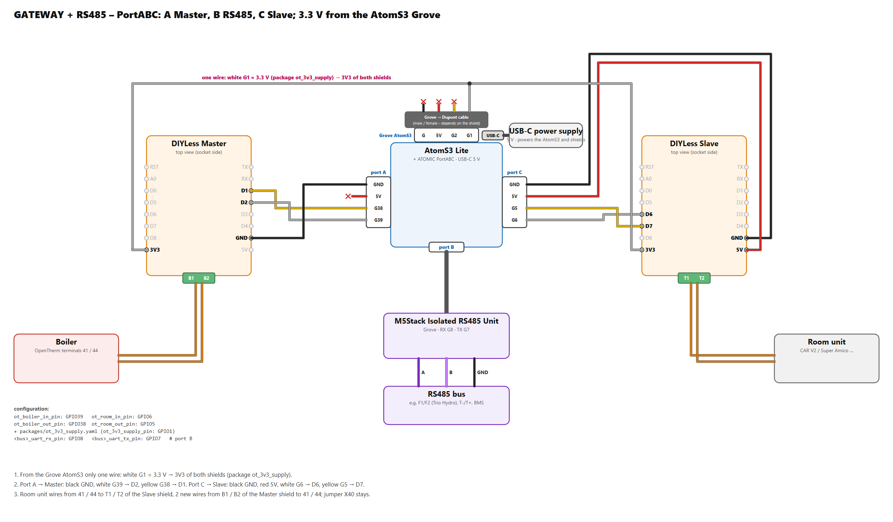

# TRIO HYDRO (Samsung outdoor unit + OpenTherm boiler) – testers wanted

**English** · [Polski](trio-hydro.pl.md)

Back to the [protocol overview](../README.md).

> **Planned – looking for testers.** There is no ready configuration for the TRIO HYDRO yet. This page collects what
> the Immergas manuals say about its buses and how the hub would connect. If you have a TRIO HYDRO (ELECTRIC or
> HYBRID 5 / 8 / 12) and would like to help, open an issue or write to me – the configuration is prepared together
> with the first installation.

The Immergas **TRIO HYDRO** is a monoblock heat pump system: the indoor unit (built-in or in a technical cabinet, 160 L
cylinder) with the **UE HYDRO HP 5 / 8 / 12** outdoor unit. The **HYBRID** version adds a **VICTRIX TERA 24 PLUS**
gas boiler that the indoor unit drives over OpenTherm. So it is another hub – the same packages, a different set of
buses than the MAGIS PRO / COMBO V2.

## Buses

From the Immergas manuals *TRIO HYDRO 5-8-12*, *TRIO HYDRO sistema HYBRID 5-8-12* and *UE HYDRO HP 5-8-12*:

| Link | Protocol | What the manuals show | Hub |
|---|---|---|---|
| Outdoor unit UE HYDRO HP ↔ outdoor-unit interface board (A22) | **Samsung NASA, F1 / F2** | terminals F1 / F2, keys K1–K4 with a 7-segment display (Tx / Rx), errors 101 / 201 / 202 / 203 – a Samsung EHS monoblock | `f1f2_` packages, listen first (as on the MAGIS PRO / COMBO V2) |
| Indoor unit ↔ boiler (HYBRID only) | **OpenTherm**, boiler terminals 41 – 44 | "Comunicazione OT con caldaia" | `ot_` packages as a **gateway**: the indoor unit stays the master, the hub sits in between |
| Indoor unit ↔ zone devices (zone panel, T / H sensor, Dominus) | **Modbus RTU, 9600 8E1**, indoor unit = master | zone panel address **41** (zone 1) / **42** (zone 2), T / H sensors 131 / 132 | hypothesis: the same zone panel protocol (0x29) the hub emulates on the MAGIS D+ / D- (`dd_` packages) |
| Interface board A22 ↔ main board | Modbus RS485, internal | error 111 "Errore di comunicazione MODBUS" | not used |

The indoor unit also has the parameter *Definizione impianto → Supervisione impianto = NO / Domin / BMS*. The manuals
give no register map or terminals for the BMS option, so it stays open.

## Hardware (planned)

**HYBRID** – one AtomS3 Lite with an ATOMIC PortABC: the OpenTherm gateway between the indoor unit and the boiler plus
the Samsung F1/F2 bus.

| Part | Where |
|---|---|
| [M5Stack AtomS3 Lite](https://docs.m5stack.com/en/core/AtomS3%20Lite) + USB-C 5 V power supply | – |
| [M5Stack ATOMIC PortABC](https://shop.m5stack.com/products/atomic-portabc-extension-base) | under the AtomS3 Lite |
| [DIYLess Master OpenTherm Shield](https://diyless.com/product/master-opentherm-shield) | **port A** (G39 / G38) → boiler VICTRIX TERA, terminals 41 / 44 |
| [DIYLess Slave OpenTherm Shield](https://diyless.com/product/slave-opentherm-shield) | **port C** (G6 / G5, + 5 V) → the indoor unit's OpenTherm output (the wires that went to the boiler) |
| M5Stack Isolated RS485 Unit | **port B** (RX G8, TX G7) → F1 / F2, listening in parallel |
| Grove → Dupont cable in the **Grove AtomS3** socket (next to USB-C) | only the white **G1 = 3.3 V** wire → 3V3 of both shields (package `ot_3v3_supply`) |

In the diagram the *room unit* is the TRIO HYDRO indoor unit: it is the OpenTherm master towards the boiler, the hub
sits between them. The indoor unit has its own mains supply, so the Slave shield does not have to power it. Shields,
pins and the 3.3 V supply: [OpenTherm boilers](opentherm-hub.md#hardware).

**ELECTRIC** (no boiler) – only F1/F2: an AtomS3 Lite with the RS485 unit in its Grove AtomS3 socket (RX G1, TX G2),
no PortABC, no OpenTherm.

**Without soldering, as two devices:** the ready-made [OT-thing](https://www.seegel-systeme.de/produkt/ot-thing/)
gateway (OpenTherm master + slave in a box, ESP32-C3) for the boiler side and an AtomS3 Lite with the RS485 unit for
F1/F2 – a configuration for the OT-thing is not prepared yet.

## What a tester would do

1. **Electric part first, read only.** The RS485 unit on F1 / F2 in parallel (it only listens), as on the
   [MAGIS PRO / COMBO V2](magis-pro-combo-v2.md#wiring). Compressor, refrigerant circuit, defrost, flow and outdoor
   temperatures, power – and a raw log of what the Samsung outdoor unit sends.
2. **HYBRID: the OpenTherm gateway** between the indoor unit and the VICTRIX TERA 24 PLUS (see
   [OpenTherm boilers](opentherm-hub.md#two-modes)): what the indoor unit asks the boiler for, flame, modulation, faults.
3. **The zone bus, recording only.** A log of the Modbus traffic between the indoor unit and the zone panel or Dominus,
   to check whether it matches the MAGIS zone panel map.

What to record: [Collecting logs](collecting-logs.md).

> ⚠️ The buses are inside the units and connect to mains-powered electronics. Disconnect the power before you open
> anything, and leave the wiring to someone qualified. Connecting third-party hardware may affect the warranty.
