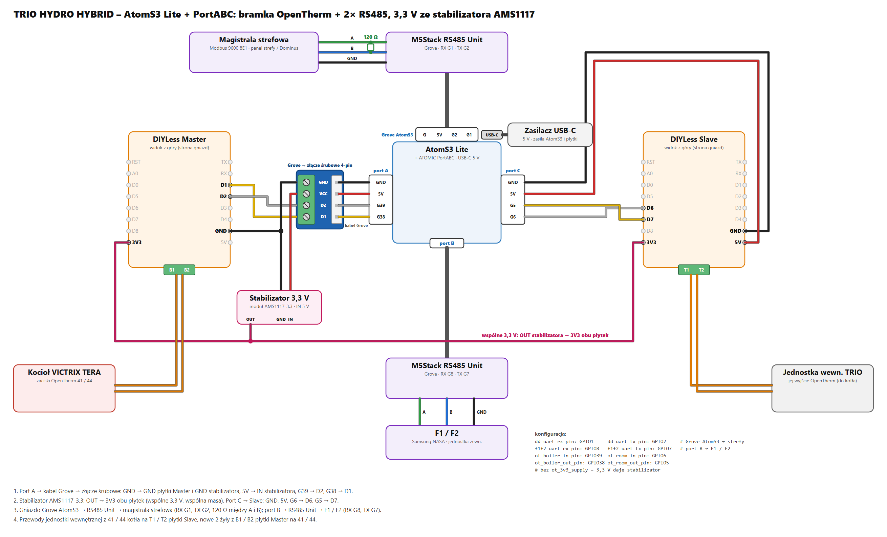
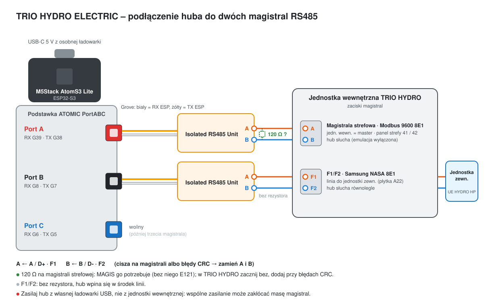

# TRIO HYDRO (jednostka zewnętrzna Samsung + kocioł OpenTherm) – szukamy testerów

[English](trio-hydro.md) · **Polski**

Powrót do [przeglądu protokołów](../README.pl.md).

> **Planowany – szukamy testerów.** Konfiguracja jest gotowa, ale jeszcze niesprawdzona na urządzeniu. Ta strona zbiera to, co
> instrukcje Immergasa mówią o jego magistralach, i to, jak podłączyłby się hub. Jeśli masz TRIO HYDRO (ELECTRIC albo
> HYBRID 5 / 8 / 12) i chcesz pomóc, załóż zgłoszenie albo napisz do mnie – konfigurację sprawdzimy i dopasujemy razem
> przy pierwszej instalacji.

Immergas **TRIO HYDRO** to system z pompą ciepła monoblok: jednostka wewnętrzna (do zabudowy albo w szafce
technicznej, zasobnik 160 L) z jednostką zewnętrzną **UE HYDRO HP 5 / 8 / 12**. Wersja **HYBRID** dokłada kocioł
gazowy **VICTRIX TERA 24 PLUS**, którym jednostka wewnętrzna steruje po OpenTherm. To więc kolejny hub – te same
pakiety, inny zestaw magistral niż w MAGIS PRO / COMBO V2.

## Magistrale

Według instrukcji Immergasa *TRIO HYDRO 5-8-12*, *TRIO HYDRO sistema HYBRID 5-8-12* i *UE HYDRO HP 5-8-12*:

| Połączenie | Protokół | Co pokazują instrukcje | Hub |
|---|---|---|---|
| Jednostka zewnętrzna UE HYDRO HP ↔ płytka interfejsu jednostki zewnętrznej (A22) | **Samsung NASA, F1 / F2** | zaciski F1 / F2, przyciski K1–K4 z wyświetlaczem 7-segmentowym (Tx / Rx), błędy 101 / 201 / 202 / 203 – monoblok Samsung EHS | pakiety `f1f2_`, najpierw nasłuch (jak w MAGIS PRO / COMBO V2) |
| Jednostka wewnętrzna ↔ kocioł (tylko HYBRID) | **OpenTherm**, zaciski kotła 41 – 44 | „Comunicazione OT con caldaia” | pakiety `ot_` jako **bramka**: jednostka wewnętrzna zostaje masterem, hub siedzi pośrodku |
| Jednostka wewnętrzna ↔ urządzenia strefowe (panel strefy, czujnik T / H, Dominus) | **Modbus RTU, 9600 8E1**, jednostka wewnętrzna = master | adres panelu strefy **41** (strefa 1) / **42** (strefa 2), czujniki T / H 131 / 132 | hipoteza: ten sam protokół panelu strefy (0x29), który hub emuluje na D+ / D- w MAGIS (pakiety `dd_`) |
| Płytka interfejsu A22 ↔ płytka główna | Modbus RS485, wewnętrzny | błąd 111 „Errore di comunicazione MODBUS” | nieużywany |

Jednostka wewnętrzna ma też parametr *Definizione impianto → Supervisione impianto = NO / Domin / BMS*. Instrukcje nie
podają mapy rejestrów ani zacisków dla opcji BMS, więc ta droga zostaje otwarta.

## Sprzęt (planowany)

**HYBRID** – jeden AtomS3 Lite z ATOMIC PortABC: bramka OpenTherm między jednostką wewnętrzną a kotłem oraz **dwie
magistrale RS485** – Samsung F1/F2 i magistrala strefowa. To zajmuje wszystkie 8 wolnych GPIO (2 płytki OpenTherm × 2
sygnały + 2 × RS485 po 2), więc 3,3 V dla płytek daje mały stabilizator, a nie GPIO.

| Element | Gdzie |
|---|---|
| [M5Stack AtomS3 Lite](https://docs.m5stack.com/en/core/AtomS3%20Lite) + zasilacz USB-C 5 V | – |
| [M5Stack ATOMIC PortABC](https://botland.com.pl/seria-atom/23346-m5stack-atomic-portabc-extension-base-modul-rozszerzen-unit-do-modulow-deweloperskich-m5atom-m5stack-a130-6972934174567.html) | pod AtomS3 Lite |
| kabel Grove + [złącze śrubowe Grove 4-pin](https://botland.com.pl/grove-konwertery-i-przetworniki/11348-grove-4-pinowe-zlacze-srubowe-5904422340063.html) | **port A** – rozgałęźnik: GND i 5 V idą do płytki Master i do stabilizatora |
| [DIYLess Master OpenTherm Shield](https://diyless.com/product/master-opentherm-shield) | port A (G39 → D2, G38 → D1, GND) → kocioł VICTRIX TERA, zaciski 41 / 44 |
| moduł stabilizatora 3,3 V: dowolny moduł AMS1117-3.3 albo gotowa [Pololu D24V5F3, przetwornica step-down 3,3 V 0,5 A](https://botland.com.pl/przetwornice-step-down/3109-d24v5f3-przetwornica-step-down-33v-05a-pololu-2842-5904422360115.html) (VIN / GND / VOUT) | IN ← 5 V z portu A, GND wspólna, **OUT → 3V3 obu płytek** |
| [DIYLess Slave OpenTherm Shield](https://diyless.com/product/slave-opentherm-shield) | **port C** (G6 → D6, G5 → D7, GND, 5 V) → wyjście OpenTherm jednostki wewnętrznej (przewody, które szły do kotła) |
| [przewody Grove → Dupont, 4-pin, żeńskie / męskie 2,54 mm](https://botland.com.pl/przewody-polaczeniowe-grove/21690-grove-zestaw-5-przewodow-4-pin-2mm-przewody-zenskiemeskie-254mm-20cm-6972934173751.html) | port C → płytka Slave; luźne przewody ze złącza śrubowego do płytki Master i stabilizatora |
| [M5Stack Isolated RS485 Unit](https://botland.com.pl/moduly-unit-moduly-komunikacyjne/19118-izolowany-modul-nadawczo-odbiorczy-rs485-modul-rozszerzen-unit-do-modulow-deweloperskich-m5stack-5904422363673.html) nr 1 | **port B** (RX G8, TX G7) → F1 / F2, nasłuch równolegle |
| [M5Stack Isolated RS485 Unit](https://botland.com.pl/moduly-unit-moduly-komunikacyjne/19118-izolowany-modul-nadawczo-odbiorczy-rs485-modul-rozszerzen-unit-do-modulow-deweloperskich-m5stack-5904422363673.html) nr 2 | gniazdo **Grove AtomS3** przy USB-C (RX G1, TX G2) → magistrala strefowa (Modbus 9600 8E1), **rezystor 120 Ω między A i B** (jak na D+/D- w MAGIS) |

Jednostka wewnętrzna TRIO HYDRO jest masterem OpenTherm wobec kotła, hub siedzi pośrodku. Ma własne zasilanie
z sieci, więc płytka Slave nie musi jej zasilać. Pakietu `ot_3v3_supply` tu **nie** używasz – G1 zajmuje magistrala
strefowa, a 3,3 V daje stabilizator. Płytki i piny: [Kotły OpenTherm](opentherm-hub.pl.md#sprzęt).

**ELECTRIC** (bez kotła) – bez OpenTherm, więc bez płytek i stabilizatora: AtomS3 Lite z PortABC i dwa moduły
M5Stack Isolated RS485 Unit na kablach Grove, porty jak w hubie MAGIS PRO / COMBO V2 – **port A** magistrala strefowa
(RX G39, TX G38, 120 Ω między A i B), **port B** F1/F2 (RX G8, TX G7), port C wolny. Samo F1/F2 potrzebuje tylko gniazda Grove AtomS3, bez
PortABC.

**Bez lutowania, jako dwa urządzenia:** gotowa bramka [OT-thing](https://www.seegel-systeme.de/produkt/ot-thing/)
(master + slave OpenTherm w obudowie, ESP32-C3) od strony kotła i AtomS3 Lite z modułami RS485 do F1/F2 i magistrali
strefowej – konfiguracji dla OT-thing jeszcze nie ma.

## Konfiguracja

| Wersja | Plik konfiguracji |
|---|---|
| **HYBRID** – bramka OpenTherm + F1/F2 + magistrala strefowa | [`examples/immergas-trio-hydro.yaml`](../examples/immergas-trio-hydro.yaml) ([otwórz na GitHubie](https://github.com/jotuera/immergas-modbus-bms-nasa-opentherm-hub/blob/main/examples/immergas-trio-hydro.yaml) · [pobierz (raw)](https://raw.githubusercontent.com/jotuera/immergas-modbus-bms-nasa-opentherm-hub/main/examples/immergas-trio-hydro.yaml)) |
| **ELECTRIC** – F1/F2 + magistrala strefowa | [`examples/immergas-trio-hydro-electric.yaml`](../examples/immergas-trio-hydro-electric.yaml) ([otwórz na GitHubie](https://github.com/jotuera/immergas-modbus-bms-nasa-opentherm-hub/blob/main/examples/immergas-trio-hydro-electric.yaml) · [pobierz (raw)](https://raw.githubusercontent.com/jotuera/immergas-modbus-bms-nasa-opentherm-hub/main/examples/immergas-trio-hydro-electric.yaml)) |

Piny zgadzają się ze schematami wyżej. Wszystko startuje **biernie** poza bramką OpenTherm (przekazuje ramki jednostki
wewnętrznej do kotła): F1/F2 z `f1f2_transmit: "false"` (tylko nasłuch), a przełączniki emulacji magistrali
strefowej wyłączone – hub tylko słucha. Pakietu `ot_3v3_supply` nie ma (3,3 V daje stabilizator).

1. Skopiuj plik do folderu ESPHome i dodaj sekrety, których używa, do `secrets.yaml`: `wifi_ssid`, `wifi_password`,
   `immergas_trio_api_key`, `immergas_trio_ota_password`.
2. Wgraj (pierwszy raz przez USB) i dodaj urządzenie w Home Assistant.
3. Sprawdź połączenie OpenTherm z kotłem i z jednostką wewnętrzną (HYBRID) oraz sniffery F1/F2 i magistrali
   strefowej w diagnostyce – potem nagraj logi ([Zbieranie logów](collecting-logs.pl.md)).

## Co zrobiłby tester

1. **Najpierw część elektryczna, tylko odczyt.** Moduł RS485 na F1 / F2 równolegle (tylko słucha), jak w
   [MAGIS PRO / COMBO V2](magis-pro-combo-v2.pl.md#podłączenie). Sprężarka, obieg chłodniczy, odszranianie,
   temperatury zasilania i zewnętrzna, moc – i surowy log tego, co wysyła jednostka zewnętrzna Samsung.
2. **HYBRID: bramka OpenTherm** między jednostką wewnętrzną a VICTRIX TERA 24 PLUS (zobacz
   [Kotły OpenTherm](opentherm-hub.pl.md#dwa-tryby)): o co jednostka wewnętrzna prosi kocioł, płomień, modulacja, błędy.
3. **Magistrala strefowa, tylko nagrywanie.** Log ruchu Modbus między jednostką wewnętrzną a panelem strefy albo
   Dominusem, żeby sprawdzić, czy zgadza się z mapą panelu strefy MAGIS.

Co nagrać: [Zbieranie logów](collecting-logs.pl.md).

> ⚠️ Magistrale są wewnątrz urządzeń i łączą się z elektroniką zasilaną z sieci. Przed otwarciem odłącz zasilanie,
> a podłączenie zostaw osobie z uprawnieniami. Podłączenie sprzętu innej firmy może wpłynąć na gwarancję.
