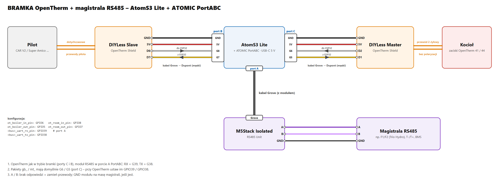

# TRIO HYDRO (jednostka zewnętrzna Samsung + kocioł OpenTherm) – szukamy testerów

[English](trio-hydro.md) · **Polski**

Powrót do [przeglądu protokołów](../README.pl.md).

> **Planowany – szukamy testerów.** Gotowej konfiguracji dla TRIO HYDRO jeszcze nie ma. Ta strona zbiera to, co
> instrukcje Immergasa mówią o jego magistralach, i to, jak podłączyłby się hub. Jeśli masz TRIO HYDRO (ELECTRIC albo
> HYBRID 5 / 8 / 12) i chcesz pomóc, załóż zgłoszenie albo napisz do mnie – konfigurację przygotujemy razem przy
> pierwszej instalacji.

Immergas **TRIO HYDRO** to system z pompą ciepła monoblok: jednostka wewnętrzna (do zabudowy albo w szafce
technicznej, zasobnik 160 L) z jednostką zewnętrzną **UE HYDRO HP 5 / 8 / 12**. Wersja **HYBRID** dokłada kocioł
gazowy **VICTRIX TERA 24 PLUS**, którym jednostka wewnętrzna steruje po OpenTherm. To więc kolejny hub – te same
pakiety, inny zestaw magistral niż w MAGIS PRO / COMBO V2.

## Magistrale

Według instrukcji Immergasa *TRIO HYDRO 5-8-12*, *TRIO HYDRO sistema HYBRID 5-8-12* i *UE HYDRO HP 5-8-12*:

| Połączenie | Protokół | Co pokazują instrukcje | Hub |
|---|---|---|---|
| Jednostka zewnętrzna UE HYDRO HP ↔ płytka interfejsu jednostki zewnętrznej (A22) | **Samsung NASA, F1 / F2** | zaciski F1 / F2, przyciski K1–K4 z wyświetlaczem 7-segmentowym (Tx / Rx), błędy 101 / 201 / 202 / 203 – monoblok Samsung EHS | pakiety `f1f2_`, najpierw nasłuch (jak w MAGIS PRO / COMBO V2) |
| Jednostka wewnętrzna ↔ kocioł (tylko HYBRID) | **OpenTherm**, zaciski kotła 41 – 44 | „Comunicazione OT con caldaia” | pakiety `ot_` jako **bramka**: jednostka wewnętrzna zostaje masterem, hub siedzi pośrodku |
| Jednostka wewnętrzna ↔ urządzenia strefowe (panel strefy, czujnik T / H, Dominus) | **Modbus RTU, 9600 8E1**, jednostka wewnętrzna = master | adres panelu strefy **41** (strefa 1) / **42** (strefa 2), czujniki T / H 131 / 132 | hipoteza: ten sam protokół panelu strefy (0x29), który hub emuluje na D+ / D- w MAGIS (pakiety `dd_`) |
| Płytka interfejsu A22 ↔ płytka główna | Modbus RS485, wewnętrzny | błąd 111 „Errore di comunicazione MODBUS” | nieużywany |

Jednostka wewnętrzna ma też parametr *Definizione impianto → Supervisione impianto = NO / Domin / BMS*. Instrukcje nie
podają mapy rejestrów ani zacisków dla opcji BMS, więc ta droga zostaje otwarta.

## Sprzęt (planowany)

**HYBRID** – jeden AtomS3 Lite z ATOMIC PortABC: bramka OpenTherm między jednostką wewnętrzną a kotłem oraz magistrala
Samsung F1/F2.

| Element | Gdzie |
|---|---|
| [M5Stack AtomS3 Lite](https://docs.m5stack.com/en/core/AtomS3%20Lite) + zasilacz USB-C 5 V | – |
| [M5Stack ATOMIC PortABC](https://shop.m5stack.com/products/atomic-portabc-extension-base) | pod AtomS3 Lite |
| [DIYLess Master OpenTherm Shield](https://diyless.com/product/master-opentherm-shield) | **port A** (G39 / G38) → kocioł VICTRIX TERA, zaciski 41 / 44 |
| [DIYLess Slave OpenTherm Shield](https://diyless.com/product/slave-opentherm-shield) | **port C** (G6 / G5, + 5 V) → wyjście OpenTherm jednostki wewnętrznej (przewody, które szły do kotła) |
| M5Stack Isolated RS485 Unit | **port B** (RX G8, TX G7) → F1 / F2, nasłuch równolegle |
| kabel Grove → Dupont w gnieździe **Grove AtomS3** (przy USB-C) | tylko biała żyła **G1 = 3,3 V** → 3V3 obu płytek (pakiet `ot_3v3_supply`) |

Na schemacie *pilot* to jednostka wewnętrzna TRIO HYDRO: to ona jest masterem OpenTherm wobec kotła, hub siedzi
pośrodku. Jednostka wewnętrzna ma własne zasilanie z sieci, więc płytka Slave nie musi jej zasilać. Płytki, piny
i zasilanie 3,3 V: [Kotły OpenTherm](opentherm-hub.pl.md#sprzęt).

**ELECTRIC** (bez kotła) – tylko F1/F2: AtomS3 Lite z modułem RS485 w gnieździe Grove AtomS3 (RX G1, TX G2), bez
PortABC i bez OpenTherm.

**Bez lutowania, jako dwa urządzenia:** gotowa bramka [OT-thing](https://www.seegel-systeme.de/produkt/ot-thing/)
(master + slave OpenTherm w obudowie, ESP32-C3) od strony kotła i AtomS3 Lite z modułem RS485 do F1/F2 – konfiguracji
dla OT-thing jeszcze nie ma.

## Co zrobiłby tester

1. **Najpierw część elektryczna, tylko odczyt.** Moduł RS485 na F1 / F2 równolegle (tylko słucha), jak w
   [MAGIS PRO / COMBO V2](magis-pro-combo-v2.pl.md#podłączenie). Sprężarka, obieg chłodniczy, odszranianie,
   temperatury zasilania i zewnętrzna, moc – i surowy log tego, co wysyła jednostka zewnętrzna Samsung.
2. **HYBRID: bramka OpenTherm** między jednostką wewnętrzną a VICTRIX TERA 24 PLUS (zobacz
   [Kotły OpenTherm](opentherm-hub.pl.md#dwa-tryby)): o co jednostka wewnętrzna prosi kocioł, płomień, modulacja, błędy.
3. **Magistrala strefowa, tylko nagrywanie.** Log ruchu Modbus między jednostką wewnętrzną a panelem strefy albo
   Dominusem, żeby sprawdzić, czy zgadza się z mapą panelu strefy MAGIS.

Co nagrać: [Zbieranie logów](collecting-logs.pl.md).

> ⚠️ Magistrale są wewnątrz urządzeń i łączą się z elektroniką zasilaną z sieci. Przed otwarciem odłącz zasilanie,
> a podłączenie zostaw osobie z uprawnieniami. Podłączenie sprzętu innej firmy może wpłynąć na gwarancję.
